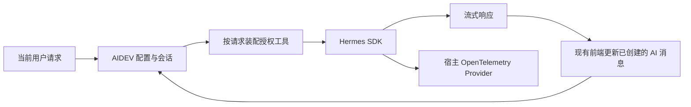

# 小鲸公共接口与 Hermes 执行适配

监控小鲸通过 `AI_AGENT_BACKEND=hermes` 在主进程中调用 Hermes SDK。AIDEV 继续管理智能体配置、会话、指令切换、知识库和工具授权。公共仓库只包含适配代码，获授权的内部镜像单独安装 SDK 与观测包。



## 引用与执行

```bash
# 监控引用ai_agent: 在项目根目录下
ln -s "$(pwd)/ai_agent" bkmonitor/ai_agent

# 日志引用ai_agent: 在项目根目录下
ln -s "$(pwd)/ai_agent" bklog/ai_agent
```

监控 Docker 镜像已显式复制 `ai_agent/`，无需另建软链接。公共默认配置沿用 `aidev`，内部 Values 显式设置 `AI_AGENT_BACKEND=hermes`。选择 Hermes 后，缺少运行时会报配置错误，不会转到其他执行内核；缺少 SDK 时隐藏该入口。

Hermes 只执行当前智能体挂载的 Python/MCP 工具及知识查询，不启用通用本地编程工具。MCP 认证沿用当前请求的用户身份；包含用户认证头的配置只在该请求内缓存。SDK session 使用用户与平台会话的组合标识，不启用 SDK 会话数据库。

本次恢复主 Agent、MCP 与平台指令映射的显式切换。平台关联子 Agent 的自动委派留作后续接入。

平台历史会恢复用户约束和已保存的工具记录，缺少结果的历史工具调用标记为未确认。会话写入沿用现有调用方职责：前端先创建 AI 消息，再根据流式响应更新它；执行适配层不另建 AI 消息。其他 API 调用方继续通过现有会话内容接口保存结果。工具过程通过 SSE 和 Trace 展示；不承诺把本轮全部工具结果持久化为下一轮历史。

流式响应沿用前端的 `text`、`think`、`done`、`error` 事件及 `[DONE]` 终止标记，空闲时发送 SSE heartbeat。执行失败或截断不发送成功完成事件；会话写入错误由原有内容接口反馈。关闭 HTTP 响应会取消本轮 SDK 调用；已开始的外部工具是否立即停止，仍取决于其 transport 对取消的支持。

## 私有运行时镜像

公共 `pyproject.toml` 和 `uv.lock` 不声明私有包或私有索引。内部 CI 在同一 Dockerfile 上启用可选构建步骤：

`bkmonitor/Dockerfile.dockerignore` 约束仓库根构建上下文，只包含 Dockerfile 使用的四个源码目录，并排除本地虚拟环境、包缓存和凭据文件。不要将开发环境的 `.venv` 或私有 Wheel 作为镜像源码复制进去。

1. 从公共锁导出完整运行依赖，保留默认 `aidev` 工具适配组，排除项目自身和本地 `bk-monitor-base` 路径。
2. 将获批准的 `bkai-hermes-core` 与 `bkai-otel-hermes` Wheel 加入同一依赖解析，生成适合目标 Python/Linux 平台的完整固定版本及哈希清单。SDK 接口最低要求分别为 `0.8.1` 和 `1.3.0`；实际版本必须同时满足监控的依赖约束。不要通过 `--no-deps` 绕过解析冲突。
3. 用 BuildKit secret 传递清单和 pip 配置；用清单 SHA256 作为非敏感构建参数校验内容并更新构建缓存。CI 可通过独立的 `ai-agent-runtime-wheels` 命名上下文提供从获授权源码打包的 Wheel，或使用 pip 配置中的私有索引。

```bash
# 在 bkmonitor/ 下导出；本地包由 Dockerfile 的公共构建步骤安装。
uv export --locked --no-dev --no-emit-project --no-emit-package bk-monitor-base \
  --format requirements-txt --no-hashes -o /tmp/monitor-public.txt

# approved-private-runtime.in 由内部 CI 固定两个已批准的私有包版本。
uv pip compile --python-version 3.11 --python-platform x86_64-unknown-linux-gnu \
  --generate-hashes --no-header --no-annotate \
  --find-links "$PRIVATE_WHEEL_DIR" /tmp/monitor-public.txt approved-private-runtime.in \
  -o /tmp/monitor-runtime.lock

# 从仓库根构建；pip.conf 及锁清单只在对应 RUN 步骤挂载。
docker buildx build --platform linux/amd64 --load -f bkmonitor/Dockerfile \
  --build-context ai-agent-runtime-wheels="$PRIVATE_WHEEL_DIR" \
  --build-arg AI_AGENT_HERMES_ENABLED=true \
  --build-arg AI_AGENT_RUNTIME_LOCK_SHA256="$(shasum -a 256 /tmp/monitor-runtime.lock | cut -d ' ' -f 1)" \
  --secret id=ai_agent_runtime_requirements,src=/tmp/monitor-runtime.lock \
  --secret id=python_package_config,src="$PRIVATE_PIP_CONFIG" \
  -t "$INTERNAL_MONITOR_IMAGE" .
```

Docker 安装阶段使用完整清单的 `--require-hashes`，随后执行 `pip check` 和运行时接口检查。任一清单、认证配置、哈希或接口缺失都会使内部构建失败。凭据不放进 `ARG`、`ENV`、镜像层或公共锁文件。

命名上下文中的 Wheel 只在安装步骤以只读方式挂载；公共构建默认使用空上下文。内部构建可以直接使用经核验的源码制品，不要求先将 SDK 发布到包索引。源码提交、构建工具版本、Wheel 及完整清单摘要应保存在内部构建记录中。

SDK 与旧监控宿主在 urllib3、PyYAML、Pillow、websockets 等依赖上可能存在冲突，须使用经联合解析和宿主测试的制品；单独安装 SDK 成功不能替代兼容验收。

## Helm Values 配置

使用现有 Chart 的 `monitor.image` 和 `monitor.extraEnvVars`，由内部 Values 选择包含 SDK 的镜像。模型凭据放在集群 Secret，通过 `valueFrom.secretKeyRef` 注入；不在 Pod 启动时联网安装包。

`extraEnvVars` 是列表，Helm 合并会替换整个列表。下面仅示意需要追加或更新的条目，不能作为短列表 overlay 直接覆盖环境已有配置：

```yaml
monitor:
  image:
    registry: registry.example.com
    repository: monitoring/monitor
    tag: approved-hermes-runtime
  extraEnvVars:
    - name: ENABLE_AI_ASSISTANT
      value: enabled
    - name: AI_AGENT_BACKEND
      value: hermes
    - name: AI_AGENT_HERMES_LLM_API_KEY
      valueFrom:
        secretKeyRef:
          name: monitor-hermes-model
          key: api-key
    - name: AI_AGENT_HERMES_LLM_BASE_URL
      valueFrom:
        secretKeyRef:
          name: monitor-hermes-model
          key: base-url
    - name: AI_AGENT_HERMES_LLM_MODEL
      value: selected-model
    - name: AI_AGENT_HERMES_LLM_PROVIDER
      value: selected-provider
    - name: AI_AGENT_OTEL_ENABLED
      value: "true"
```

| 配置 | 默认值与作用 |
| --- | --- |
| `AI_AGENT_HERMES_HOME` | `/tmp/bkmonitor-hermes`，必须可写；只写固定身份与受控配置 |
| `AI_AGENT_HERMES_MAX_ITERATIONS` | `15`，限制模型/工具循环 |
| `AI_AGENT_STREAM_HEARTBEAT_INTERVAL_SECONDS` | `10`，流式空闲心跳间隔 |
| `AI_AGENT_HERMES_LLM_API_KEY/BASE_URL/MODEL/PROVIDER` | 配齐后走指定 OpenAI 兼容端点；密钥及地址通过 Secret 注入 |
| `AI_AGENT_HERMES_ACCESS_TOKEN` | 未配置直连密钥时，沿用 AIDEV 模型网关及应用认证，可选补充网关 access token |
| `AI_AGENT_OTEL_ENABLED` | `false`；启用时复用监控已经初始化的 TracerProvider 与 exporter |
| `AI_AGENT_OTEL_CAPTURE_CONTENT` | `false`；是否采集消息及工具内容，按环境要求选择 |

不在适配层新建第二个 Provider 或复制其他应用的上报 Token。Trace 沿用宿主 HTTP/Celery 上下文，SDK 与观测插件产生 Agent、模型和工具 Span；会话内容仍通过原有平台接口保存。

## 验证

```bash
# 从仓库根；测试不访问 AIDEV、业务数据或真实模型。
bkmonitor/.venv/bin/python -m pytest -c /dev/null --rootdir=. ai_agent/tests -q

# 从 bkmonitor/；内部镜像或环境必须通过 required 检查。
.venv/bin/python scripts/check_ai_agent_runtime.py --required
```

不含私有 SDK 的公共开发环境会跳过实际 SDK 用例；内部运行时验收必须确认这些用例没有跳过。测试使用固定 HTTP 模型响应，覆盖真实 SDK 的同步/异步工具、流式/非流式和 Trace 关联，不能据此宣称真实模型效果或业务试点通过。上线前还需完成内部镜像构建、Chart 渲染、用户权限正反例、页面会话与真实工具验收。
