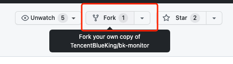

# 日志前端构建使用说明

#### 安装和更新前端依赖（Node.js 固定为 `26.12.1`）

```bash
cd bklog/web
nvm install 26.12.1
nvm use 26.12.1
node --version # 应输出 v26.12.1
corepack enable
corepack prepare pnpm@10.32.1 --activate
pnpm --dir packages/web-v3 --ignore-workspace install
```

不要在 `bklog/web` 根目录执行 `npm ci`。根目录没有 `package-lock.json`，锁文件在 `packages/web-v3/pnpm-lock.yaml`。`packages/web-v2/package-lock.json` 是封版 Vue 2，里面包含 `bk-magic-vue`（MagicBox）。

如果您尚未安装过 `nodejs` [详细安装参见](https://nodejs.org/zh-cn/download/)

# 本地开发模式

## 前置准备

1、项目仓库: https://github.com/TencentBlueKing/bk-monitor 请确保拥有该仓库的 Write 及以上的权限

点击页面右上角的 Fork ，创建个人的 Fork 仓库



2、Clone：克隆仓库到本地
```
git clone https://github.com/{username}/bk-monitor.git
```

3、添加上游远端
```
git remote add upstream https://github.com/TencentBlueKing/bk-monitor.git
```
4、 设置提交者信息。切勿使用内部用户名及邮箱
```
git config user.name "your_github_username"
git config user.email "your_github_email"
```

5、配置GPG Key用于commit签名
[关于提交签名验证](https://docs.github.com/zh/authentication/managing-commit-signature-verification/about-commit-signature-verification)

### 安装gpg
注意：在生成新 GPG 密钥之前，请确保已验证你的电子邮件地址。 如果尚未验证电子邮件地址，将无法使用 GPG 对提交和标记进行签名。有关详细信息，请参阅“验证电子邮件地址”。

下载并安装适用于操作系统的 [GPG](https://www.gnupg.org/download/index.html) 命令行工具。 一般来说，我们建议安装适用于您的操作系统的最新版本。

打开Git Bash。

### 生成GPG Key并导出公钥
```
gpg --full-generate-key
```

#### 创建过程中它会要你输入各种参数。

- 秘钥类型: RSA

- 秘钥长度: 4096

- 有效期: 3y (自己看想要多长)

- 姓名和邮箱：确保和github config配置的user.name和user.email保持一致（邮箱可以使用Github的隐私邮箱）

- 密码：以后每次加密操作都会让你输入密码，可以为空

#### 创建完成后通过以下命令查看创建好的GPG Key，记下sec那一行/后的GPG key ID，在这里是3AA5C34371567BD2，后续使用的GPG_Key_ID都是从这里来的。

```
$ gpg --list-secret-keys --keyid-format=long
/Users/hubot/.gnupg/secring.gpg
------------------------------------
sec   4096R/3AA5C34371567BD2 2016-03-10 [expires: 2017-03-10]
uid                          Hubot <hubot@example.com>
ssb   4096R/4BB6D45482678BE3 2016-03-10
```

#### 然后通过以下命令导出公钥，也可以添加--output将公钥导出到指定的文件里
- GPG_Key_ID 可以来自上一步查看 sec 也可以使用注册的 email

```
# 导出公钥
$ gpg --armor --export GPG_Key_ID | email

-----BEGIN PGP PUBLIC KEY BLOCK-----
xxxxxxxxxxxxxxxxxxxxxxxxxxxxxxxxxxxx
-----END PGP PUBLIC KEY BLOCK-----

#### 将公钥导出为文件
$ gpg --output ~/.ssh/public.gpg --armor --export GPG_Key_ID | email
```

### 在Github上配置GPG Key公钥
#### 通过 https://github.com/settings/keys Github -> Settings -> SSH and GPG keys -> New GPG key 在页面上配置你的公钥。

#### 也可以使用GitHub CLI直接导入GPG Key，只需要使用上一步到处的公钥文件即可。
```
gh gpg-key add ~/.ssh/public.gpg
```

### 在Git上配置GPG Key
```
# 然后在本地项目配置 GPG Key 即可。
git config user.signingkey GPG_Key_ID

# 开启自动commit签名
git config commit.gpgsign true

# 开启自动tag签名
git config tag.gpgsign true
```

## 本地启动

默认启动 Vue 3（TDesign），不加载 MagicBox：

```bash
cd bklog/web
pnpm dev
```

地址为 `http://localhost:4175`。代理和登录只读本地 `bklog/web/.env.local`（从 `.env.example` 复制）和 `bklog/web/.cookie`，这两个文件不提交。

封版 Vue 2 仍使用 MagicBox，需要对照时再执行 `pnpm dev:v2`（端口 8001）。它的依赖在 `packages/web-v2`，用 `npm ci` 安装，并在该目录自建 `local.settings.js`。

### 本地 `hosts` 文件配置

V3 默认监听 `localhost:4175`。如果 `BKLOG_DEV_HOST` 写成了自定义主机名，把该主机名指到 `127.0.0.1`。

### 前端环境变量配置

V3 把 `bklog/web/.env.example` 复制为 `bklog/web/.env.local`，只在本地填写，不要提交：

```
BKLOG_DEV_PROXY_URL=
BKLOG_DEV_HOST=localhost
BKLOG_DEV_ALLOWED_HOSTS=
BKLOG_DEV_URL=localhost:4175
BKLOG_LOGIN_HOST=
BKLOG_CSRF_TOKEN=
```

登录 Cookie 放在 `bklog/web/.cookie`。

## 生产构建

### 构建

  ```bash
  npm run build
  ```

### 分析构建产物组成

  ```bash
  # 生产环境构建产物分析
  npm run analyze
  ```

## 格式化以及校验

主应用使用以下工具：

- Prettier：格式化 `src` 中的 JavaScript、TypeScript、TSX 和 Vue 文件。
- ESLint：检查 `src` 中的 JavaScript、TypeScript、TSX 和 Vue 语义问题。
- Stylelint：检查 `src` 中 Vue style、SCSS、CSS 和 Sass。

### 增量检查

提交代码时，Git Hook 会对暂存的相关文件执行自动修复和检查。CI 当前只执行主应用构建，不执行格式化、ESLint 或 Stylelint 检查。

### 全量命令

以下命令用于手动检查或后续存量治理。本地提交的增量检查不会调用这些全量命令。

```bash
# Prettier
npm run format
npm run format:check

# ESLint
npm run lint
npm run lint:fix

# Stylelint
npm run stylelint
npm run stylelint:fix
```
