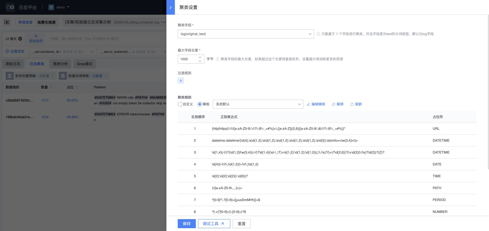
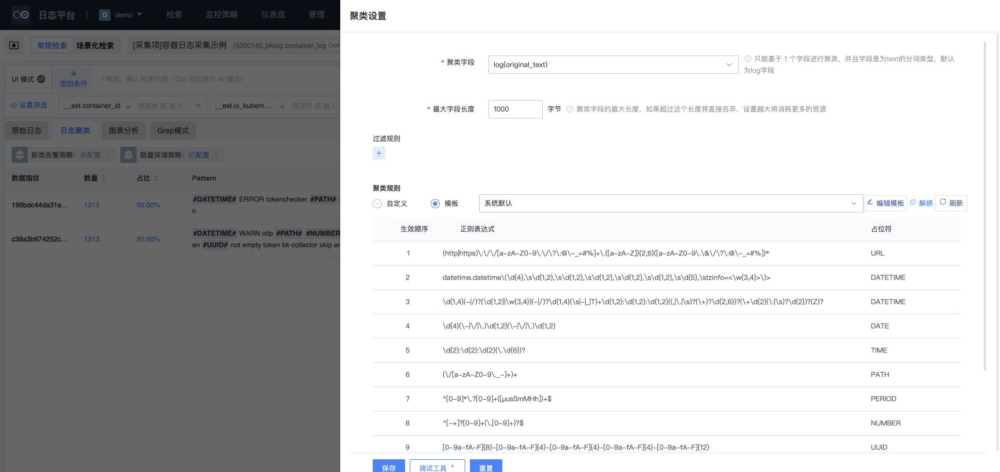

# 迁移对齐丢失的根因、扩散范围与方案修订

实施更新（2026-11-12 批次 03）：根状态及内部旧调用清理已落地，详见 [实施记录-03-根状态原生Pinia与Monitor聚类验证](实施记录-03-根状态原生Pinia与Monitor聚类验证.md)。历史分析继续保留；全业务、统一视口视觉及真实 APM/Trace 宿主链路仍未全部验收。

日期：2026-11-12。审查基点：`35e1a51ccb`。本次只分析、采集和修订实施方案，**没有修改 V2/V3 业务源码，没有保存聚类配置或变更既有资源，没有执行产品修复**。

## 1. 结论

问题已经超出主题、间距、图标的细节调整。当前有一条可直接追溯的丢失链：

**业务保留旧组件调用 → 以全局旧名注册 TDesign 包装组件 → 包装只转换部分 props/事件 → 插槽、实例方法、关闭流程、选项内容和旧样式约束未完整实现 → 页面能显示、请求能返回，但用户实际操作不等价。**

聚类表头不是 V2 需要迁移的新下拉功能，而是原先的漏斗触发器在包装层被丢弃后，退回成 TDesign 默认输入框和下拉箭头。聚类设置不只是“风格不同”：表单标签布局、抽屉关闭契约、过滤规则弹层的实例 API 都有未完成迁移的部分。

其他业务存在同类源码缺口，不能把它们归为聚类模块的孤立问题。此次不是全业务真实操作验收，跨模块扫描结果也不能解释为全部缺陷已复现。

此前方案已经要求源码契约、完整闭环和浏览器证据，方向并非没有写到这些内容。**真正缺口在落地粒度和准入约束**：业务旧名调用仍大量存在，局部修复与校准持续增加，但没有逐个证明生产引用链中的组件契约已被完整消费，也没有把业务迁移未完成作为发布验收的硬条件。

## 2. 证据等级与本次边界

- `LIVE_OBSERVED`：16176 真实页面中观察到的交互/布局/错误，仅证明本次具体状态。
- `SOURCE_CONFIRMED`：V2 调用与 V3 实际适配实现之间可直接证明的契约缺口。
- `CANDIDATE_REQUIRES_ROUTE_VALIDATION`：其他文件出现同类调用，未逐个确认运行可达性、条件分支和真实用户影响。
- `NOT_ASSESSED`：原生 TDesign 组件的全部使用、动态别名、隐式库行为和全业务流程尚未完整检查。

浏览器采用已打开的 8001/4175、索引 16176、空间 bkcc__5000140。V3 当时 URL 未显式携带 bizId，V2 携带 bizId=5000140；两者均显示 demo。使用相对近 15 分钟，结果数量随时间变化，且未统一固定响应、配置加载时点和全部 URL 参数，故**不进行数据等价判定或配对像素通过判定**。抽屉的初次截图可能包含加载状态，不能拿初始字段值/空规则和另一端加载完成值比较。

浏览器检查期间页面状态发生变化，后续截图中出现其他浮层/管理页，因此停止了继续操作。非目标状态截图不用于聚类设置结论；每份有效证据与限制见 `runs/alignment-audit-20261112/evidence-index.json`。

## 3. 聚类实际引用链

V3 默认检索链：

`app/router/retrieve.ts → features/retrieval/retrieve-hub.tsx → workspace/index → workspace/search-result/index.tsx → workspace/search-result/log-clustering/index.tsx`。

表头：`log-table/index.tsx → main-header/index.tsx → filter-operate/index.tsx → 全局 bk-select → platform/compat/tdesign/legacy-bk-controls.tsx 的 BkSelect → TDesign Select`。

聚类设置：`top-operation/index.tsx → cluster-config/index.tsx → bk-sideslider/BkSideslider → edit-config/index.tsx → bk-form/BkForm、FilterRule、RuleOperate、RuleTable、RuleConfigOperate`。

正确 V2 参考为 `packages/web-v2/src/views/retrieve-v3/search-result/log-clustering/`。目录名 retrieve-v3 仍在 Vue2 主应用内。不能用 V3 的 workbench 旧分支、ES 集群管理、或另一套 bkui-vue SDK 包装替代这个链路的验收。

`app/bootstrap/configure-app.ts:66` 仍调用 `installLegacyBkControls(app)`。这证明旧名业务调用现在仍在被执行，并非仅第三方包内部保留的名字。这里所谓适配，并没有加载原 bk-magic-vue 包，但业务调用的原契约仍然需要实现。

## 4. 聚类的具体丢失点

### C01：漏斗触发器被默认下拉框替代

- V2：`views/retrieve-v3/search-result/log-clustering/log-table/main-header/filter-operate/index.tsx` 使用 `slot='trigger'` 画 funnel 图标；`extension` 放确定/重置。
- V3：对应 `filter-operate/index.tsx:95` 已改为 `v-slots.trigger`，意图仍然是漏斗。
- 断点：`legacy-bk-controls.tsx:328–368` 的 BkSelect 仅转交 `panelBottomContent:slots.extension` 和 `empty`，没有消费 trigger，也没有转成 TDesign 的自定义触发方式。
- 结果：责任人、备注两列表头出现普通选择输入框及箭头。页面截图/AX 已观察到。
- 性质：`LIVE_OBSERVED + SOURCE_CONFIRMED`。不是颜色或 icon 字体缺失；只隐藏边框/箭头会继续掩盖契约丢失。

追溯 `3c75f4662f` 的同名业务文件和适配文件，已经能看到业务 trigger 插槽与适配未转交的组合。最近同步 master 的 V3 提交 `e4aac98795` 没有修改这两个文件，故不能把该表头问题归因于最近这 9 项 master 同步。历史提交只用于定位问题存在时间，不作为功能已通过的证明。

### C02：确定/重置后的关闭方法没有实现

- V3 同一组件 `:64/:70` 调用 `selectRef.value?.close()`。
- BkSelect 的 setup 没有 expose，也没有原生 Select ref；因此包装实例没有对调用方提供 close。
- `?.` 只保护 ref.value 是否为空，不保证 close 方法存在。
- 性质：`SOURCE_CONFIRMED`。本次没有点击确定/重置触发筛选；不能声称已实机复现此异常。后续需验证草稿、确定后生效、重置和关闭完整顺序。

### C03：选项渲染与语义被缩减

- 表头每个 bk-option 内包含 checkbox 和 option-name 提示内容。
- `legacy-bk-controls.tsx:313–326` 的 optionNodes 将选项压成 `{label:String(...),value}`，丢弃子节点、disabled 等属性；option-group 递归后也不保留分组语义。
- 表头原来组合的勾选、截断和提示，不会由“label/value 可显示”自动还原。
- 性质：`SOURCE_CONFIRMED`；表头每个选项的键盘、鼠标与勾选联动仍待独立对照。

### C04：聚类设置保留了竖排表单调用，包装没有对应布局

- `cluster-config/edit-config/index.tsx` 传 `form-type='vertical'`、label-width=200。
- V2 bk-form 的 formType 会添加 `bk-form-vertical`，决定标签与控件上下排列；V2 实际设置页也如此。
- BkForm 仅声明 model/rules/labelWidth，未将 form-type 转成标签布局。安装的 TDesign Form API 中 `layout` 指表单排列方式，标签位置另由 labelAlign 控制，其默认值是 right。不能把两个库同名的 vertical 理解为同一语义。
- 实际 V3 截图中标签在控件左侧，保留 200 宽标签区，V2 标签位于控件上方。
- 性质：`LIVE_OBSERVED + SOURCE_CONFIRMED`。这不是只补一个 margin 的问题。

### C05：聚类设置抽屉的旧关闭回调未承接

- `cluster-config/index.tsx:60–82` 仍依靠 before-close 将 `showEditConfig=false`，未监听 update:isShow。
- `legacy-bk-controls.tsx:620–664` 没有声明/调用 beforeClose。原生 Drawer onClose 只触发包装的 update:isShow、animation-end；并未回调业务的 before-close。
- 因此关闭按钮/遮罩等关闭来源与业务受控状态之间存在断口。Drawer 还改变了原关闭入口和头部结构，原 body 高度计算继续假定 52px 标题。
- 性质：`SOURCE_CONFIRMED`，不是本次已证明所有关闭来源都失败；尚需分别验证关闭按钮、遮罩、Escape、内部 close 以及未保存确认。

### C06：共享过滤规则弹层调用旧实例方法，已出现运行时异常

- `features/collection/filter-rule/config-rule/index.tsx:277/:281` 调用 showHandler/hideHandler，ref 绑定 bk-popover。
- BkPopover `legacy-bk-controls.tsx:816` 的 setup 不接收 expose，也没有提供这些方法，只渲染 Popup。
- FilterRule 父组件在 window click 时调用子组件 hide；子组件再调用缺失的 hideHandler。
- 打开聚类设置过程中出现 `TypeError: popoverRef.value.hideHandler is not a function`，栈指向 config-rule 和 handleClickOutside，已保存 AX 文本。
- 性质：`LIVE_OBSERVED + SOURCE_CONFIRMED`。这是共享组件异常，不能作为可忽略的控制台噪声；只补聚类页外观不会消除它。

### C07：旧 DOM 样式继续约束新 DOM

例如表头 `filter-operate/index.scss` 还包含 `.bk-options/.bk-option/.bk-option-content/.bk-select-extension`。TDesign 的实际 popup 与 option 结构不同，单纯保留 SCSS 并不证明命中了真实节点。聚类设置继续使用 52px 标题和原表单结构假设，Drawer 又挂载到 body，局部/祖先样式可能不再覆盖。此项需逐条检查命中关系与计算样式，不能把全部旧选择器一律判为失效。

同时，当前 BkForm.validate 已显式将无效结果转换为 reject；**本次没有发现它在这里无条件放行校验**，不能把其他页面曾发生的问题直接套到聚类设置。

## 5. 其他模块的同类问题

本次只读扫描以当前注册表中真正存在的旧名组件为准，排除平台适配目录和 BkLogPopover 等自有组件的名称误判：业务与 shared 源码共有 **1428 个注册旧名组件调用位置，涉及 227 个文件**。这是调用位置数，不是独立组件数、路由覆盖或缺陷数，也不表示全部在 16176 可达。

对七种明确模式扫描得到 **104 处候选、59 个文件**，跨类型重叠按文件去重；可能包含 classic/status/非当前入口，未把所有候选记为已复现缺陷。逐项位置见 `runs/alignment-audit-20261112/source-contract-risks.json`。

- 自定义 Select trigger 未转交：14 处/11 文件，涉及归档、ES 集群旧状态页、采集、索引集、检索。
- Select close 实例方法未 expose：3 处/2 文件，涉及聚类表头和采集列表选择器。
- 自定义选项内容被压平：25 处/19 文件，涉及归档、采集、提取、索引集、检索。其中部分子内容仅重复 label，不能全部算可见功能损失。
- 选项 disabled 被丢弃：11 处/10 文件，涉及归档、采集、提取、检索。会影响禁用/去重/权限提示等前端交互；后端是否阻止提交须另验，不能推断后端权限被绕过。
- Drawer before-close 未承接：13 处/13 文件，涉及归档、ES 集群旧状态页、采集、提取、Grok、检索。
- 竖排标签布局未映射：26 处/25 文件，涉及归档、授权、清洗、集群、采集、Grok、检索。
- showHandler/hideHandler 调用：12 处/8 文件，涉及采集、提取、检索。可解析 ref 的一部分确认绑定 bk-popover；其余接收对象未解析，保留待分析，不能全部按同一 API 错误处理。

三个跨模块的直接源码例子：

1. `features/collection/current/components/common-comp/drag-tag.tsx:261` 的 bk-select 使用“加号” trigger；同时通过 option.disabled 避免重复添加。两个契约都经过上述不完整转换，需验证新增标签入口与重复项。
2. `features/archive/current/archive-list/list-slider.tsx:275/:291` 根据采集管理权限和存储源权限设置 option.disabled；适配结果不保留 disabled。应检查候选项选择与提交校验，不能只看归档表单可打开。
3. `features/extraction/current/extract-task/task-create/files-input.tsx:97` 在选择后调用绑定 bk-popover 的 hideHandler，与聚类异常属于相同方法缺口，尚未在该页实机执行。

FilterRule 被聚类设置、聚类接入及清洗规则操作等直接引用，后者又用于模板管理。一个挂在 window 的 click 错误会跨组件边界暴露。应先登记共享组件的生产调用方，再划分独立验收模块。

### 表格还有独立的契约缺口，未混入上述七类计数

人工继续核对发现，`legacy-bk-controls.tsx:142–241` 的 BkTable 转列时没有将 sortable 映射为 TDesign sorter，也没有转发排序事件；对 type 只特别处理 selection，未实现 expand 的展开列/展开内容协议。

具体调用包括客户端日志 `features/client-logs/management/user-report/report-table.tsx:514`、提取任务 `features/extraction/current/extract-task/task-list/index.tsx:524` 的 sortable=custom，以及归档 `features/archive/current/archive-list/index.tsx:327` 的 type=expand。它们是额外的源码契约缺口，需核对实际路由和用户操作，尚未逐页实机验证，不包含在 104 处七类扫描统计内。

这也说明“Table Header 多出控件”不能统一归因于 TDesign Table：日志聚类使用自绘 HTML 表头和 BkSelect，管理列表才可能走 BkTable 转换；两种链路必须分别建模。

### 聚类设置的实际布局参考

以下仅用于查看标签方向、控件组合和标题结构，不作为固定响应的像素基线。左侧/背景的日志结果数量不参与比较。

V2 加载完成的设置：

V3 设置：

## 6. 为什么现有更新与验证没拦住

### 6.1 把 API 近似转换当成组件替换

Button/Input 等简单组件能局部替换，但 Select/Form/Drawer/Popover 是交互协议。现在的包装以 prop 映射和默认渲染为主，没有逐项登记调用者需要的 slots、expose、事件顺序、默认值和隐式键盘行为。保持业务处理器源码并不等于这些处理器仍能被正确触发。

### 6.2 业务与第三方适配边界没有真正完成切割

用户此前明确要求业务组件直接迁移 TDesign，仅第三方保留兼容。当前却仍全局注册旧组件，业务大量使用它们。“依赖已移除/名称由 TDesign 接住”和“业务原生迁移完成”是两个事实。前者不能替代后者。

### 6.3 验收对象偏离真实调用链

`tests/cluster-native-interactions.test.mjs` 读取 `features/clusters/current/cluster-manage/`，验证 ES 连接、表单和集群表格，不是日志聚类。SDK Select 用例读取 `platform/compat/tdesign/bkui-vue.ts`，而聚类表头走的是另一个 BkSelect。名字相似、断言数量多，不能作为该模块的覆盖证明。

### 6.4 局部通过没有升级为完整模块契约

63 条快速回归只覆盖上下文共用控件、Registry、收藏和克隆。manifest 内的聚类 V2 文件摘要是追溯输入，**不是聚类用例**。它未登记日志聚类的表头/设置浏览器场景。工具已声明部分范围，这个声明应当保留；后续不能继续据此评价全业务进度。

公共样式/兼容层变更即使触发了现有全部四组，也仍未覆盖聚类的实际调用方。“触发所有已登记组”不能代替“回归所有受影响的生产调用方”。上一轮基准固化有助于复查已验证部分，但还不足以支撑用户要求的全业务还原，必须补足这层覆盖关系。

### 6.5 只验证“出现/能点”，缺少“不可多出/不可丢失”的断言

如果只找“责任人”和“备注”文本，两边都有，表头就会被误认为通过。应同时断言触发器种类、数量、占用尺寸、默认选中展示以及不存在普通输入框。类似地，表单字段名都存在也无法发现标签方向、关闭路径和键盘行为差异。

### 6.6 构建和源码审计没有形成业务验收门禁

当前 package.json 的 verify 包含 boundaries/ai/test/build，没有运行业务旧控件清零检查 `check:tdesign`。现有 business-control-audit 能报未完成，但其启发式还会把自有 BkLogPopover 等识别为旧组件候选，需精确注册表/来源分类。即使将其加入命令，它也只能拦结构残留，不能证明交互等价。

编译成功只证明当前语法和打包可用，`any` ref 和全局组件会让缺失的 hideHandler/close 逃过类型检查。历史测试失败、未验收路由、过期 V2 证据仍存在时，全量通过结论必须继续禁止。

## 7. 后续方案如何改，不在本次直接修复

### A. 先建立生产引用链与契约消费表

每个功能从真实路由开始，列出默认/普通/场景/嵌入分支、共享子组件及实际注册来源。每个交互登记：V2 props 默认值、具名/作用域插槽、实例方法、事件顺序、状态转换、校验及取消、挂载节点、CSS 结构依赖、键盘和外部关闭。

每个 V2 契约项必须有明确 V3 消费位置与验证用例；无法对应的项标为丢失/待验证，不能留在 attrs 中算迁移成功。三方 SDK 包装与业务组件采用不同台账，不再混用通过记录。

### B. 用聚类建立完整试点，但先覆盖共享断点

先分析 Select/option、Popover 实例、Form 标签、Drawer 关闭的所有实际业务调用方，按需求定义原生 TDesign 组合。业务侧逐组件迁移，不把继续扩充旧名全局库作为最终方案；尚未迁移的调用方单独保留未完成状态，禁止先删除适配层导致其他功能崩溃。

聚类试点按以下闭环拆分，均先建立 V2 行为基准，之后再安排实现：

1. 表头默认布局、列宽/拖拽、滚动同步、排序循环及互斥。
2. 责任人/备注触发、选项、草稿、确认、重置、外部关闭、搜索/键盘；单选备注仍按 V2 实际行为建模，不能自行换规则。
3. 设置打开/回填/加载/失败、竖排布局、字段范围、数值边界和提示。
4. 过滤规则增改删、AND/OR、字段操作符和值、弹层内外点击及卸载。
5. 自定义/模板切换、绑定/解绑、导入/导出、恢复默认、搜索、排序、编辑和调试。
6. 保存成功/校验失败/接口失败、未保存关闭、返回与重入。写入仅用新建专用资源。
7. 无权限、外部版、分组/同比/新类、APM/Trace 相关分支。

以上是后续工作分解，不表示已经实现或验收。聚类模块在完整闭环通过前保持未验收。

### C. 改验收产物与断言

每个场景同时登记正向能力和禁止回归项。例如：漏斗入口存在且仅一个、不出现普通 Select 输入框；取消不提交；无权限选项不可选；单次点击只触发一次；关闭后窗口监听器清理；子弹层位于父层之上且可点击。

源码事件测试必须保留真实组件组合，使用独立的 TDesign/适配契约用例证明 slots 和 expose，而不是把实际控件替换为没有行为的字符串桩后宣布交互通过。浏览器断言验证可见性、命中、键盘和请求效果，截图记录主页面和全部浮层状态。

业务通过、视觉通过、发布通过分开。未知分支进入分母，不由删路由、删断言或遮罩截图消除差异。

### D. 按同类风险跨模块验收

优先级建议：

- P0：已复现运行异常、缺失实例方法、关闭链断裂、disabled 丢失等影响真实操作的问题，先定位所有共享调用方。
- P1：聚类完整试点，以及相同 Select/Form/Drawer/Popover 模式的采集、归档、提取、索引集、清洗与模板、授权等页面。
- P2：其他原生 TDesign 用法与剩余控件、路由、嵌入和发布场景。没有命中本次七条模式的模块并不等于安全。

跨模块修复以生产组件族为横向单元，以完整业务闭环为纵向单元。共享实现修改后必须回归已经验收的纵向闭环。

### E. 建立后续更新的准入条件

每次 master/V3 更新均记录受影响的 V2/V3 文件、契约差异、调用方、场景、截图与明确未覆盖项。旧 V2 摘要变化时，先重建版本化源码/响应基准，不复用旧通过。检查发布产物是否包含旧名业务注册、运行时异常，以及当前模块是否仍使用兼容调用。

清零检查应使用准确注册表并区分业务、自有组件和三方。最终业务源码不得依赖旧名注册；完成一个组件族后再撤销对应业务注册。日期选择继续使用支持 Vue3 的 @blueking/date-picker，不纳入重写。

AI Native 的服务类型、目录和可识别契约继续保留，但它们不能代替用户交互等价证明。下一步实施的基本单位应从“文件替换了哪些组件”改为“某生产业务场景的全部契约已经实现并验收”。

## 8. 本次产物与重跑

- 此分析报告：根因、引用链、证据等级、跨模块范围和修订方案。
- `runs/alignment-audit-20261112/source-contract-risks.json`：104 处候选的文件/行、类别、源码摘要及统计边界。
- `harness/audit-ui-contracts.mjs`：只读源码扫描；运行后写审计结果，不修改业务源码。此工具不是验收工具，不能给出功能通过率。
- `runs/alignment-audit-20261112/evidence-index.json`：浏览器证据、有效/非配对状态和未执行操作。

从 bklog/web 执行 `node analyze-info/harness/audit-ui-contracts.mjs`。结果应按 HEAD、摘要和时间解释；重新运行更新当前审计结果前请另存旧版本，不覆盖已被验收引用的证据。
