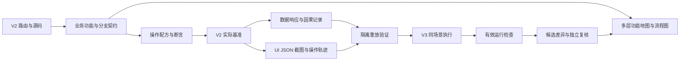

# V2 基准重建分析与实施计划

日期：2026-11-11。状态：**待用户评审，尚未开始实施**。

本轮只提交原始记录审查、当前源码核对和新的落地方案。没有执行新的浏览器采集、没有修改 V2/V3 源码，也没有清理 `analyze-info`。评审确认后才进入下面的实施阶段。

## 一 结论与目标

旧方案的问题不只是漏了若干场景，而是分析对象、采集方法和通过条件都不足以支撑“全功能对齐”。继续往旧脚本中添加按钮名称和特殊等待，只会增加运行量，不能建立可信基准。

新方案以 **V2 源码中的业务能力和状态迁移** 为分析对象，形成以下证据链：

**入口与条件 → 用户动作 → 处理器和状态变化 → 请求与完整响应 → UI 语义与布局 → 后续操作和退出清理。**

目标产物有两条互相关联的链：

- **数据基准**：URL 解析、状态转换、请求语义、响应数据、字段转换、渲染输入和副作用；可以在隔离环境重放，并校验重放结果。
- **UI 基准**：每个业务状态的语义、位置、层级、滚动、遮挡、焦点和实际交互；以 JSON 为主要结构化材料，同时保存截图和操作轨迹。

完成标准是可追溯、可重放、可独立复核的业务场景集合。路由地址数、点击数、文件数和脚本退出码各自只能证明对应事实。

本次没有测量“有效率不到 5%”这一比例；它是用户对执行效果的评价。下面的结论来自原始记录和本次只读源码检查，不给该比例添加伪精确统计。

## 二 本次分析依据及其可信边界

### 2.1 原始输入

- [完整可读记录](../analyze-info/export-6ce92bfb.md)。SHA256：`7171ce7285b94405a05d996820773643739bc117a4a0f04112e1a51ebc489b5d`。
- [JSONL 原始记录](../analyze-info/export-6ce92bfb.jsonl)。SHA256：`9adb2ce774c0a1486d77b5eadd2fb2998fbb930dedc6ef0b38f1f887fbe334fd`。

本次逐行解析 JSONL，共 408 条顶层记录：368 条 assistant、37 条 user、3 条 turn_ended 元数据；内容块包含 624 次工具调用输入。user 记录中有重复转述和工具环境说明，不能当作 37 条独立业务需求。

**该导出没有工具结果块。** 工具调用输入能证明“请求执行什么”，不能证明执行成功、页面实际状态或报告准确。“跑完 139 条”“全部 to-do 完成”等属于历史声明；缺失工具结果不等于工具没有执行过，但不能用该导出独立证实这些声明。

以下引用均为 JSONL 的一基行号，不是可读 Markdown 的行号。历史记录中的命令和指令只作为审查材料，不在本轮执行。

### 2.2 旧结果的处理

`analyze-info` 中除两份 export 输入外，目前有 344 个旧文件，合计 16,512,717 字节，包括 capture 脚本、case、响应/mock、覆盖率、流程图和报告。

评审通过后，清理范围为这些旧文件。两份 export 原样保留，校验摘要。新实现从新的目录和格式开始，不导入旧覆盖率、旧 PASS/FAIL、旧差异列表或旧 Mock。

旧结果即使包含看似合理的结论，也需要从当前源码和新运行证据重新建立。旧结果仅可用于解释失败过程，不能作为 V2 期望值。

V2/V3 中现有未提交修改是另一范围：当前存在 V2 埋点和 V3 选择器等修改。**清理 analyze-info 不等于回滚这些源码。** 实施第一步先登记来源与差异，逐项判断，禁止批量覆盖用户改动。

## 三 旧方案为何失效

### A 把地址可达当作完整功能覆盖

原始记录第 367 行称静态地图有 73 条 journey、实际只跑了 11 条；第 382 行又给出 139 个地址“全部落地”的结论。第 388 行明确更正：139 个地址主要检查页面文本，不是逐个菜单和交互。

问题是统计单位被替换：地址访问替代状态迁移，首屏检查替代功能验收。新方案必须分别登记地址可达、功能发现、条件分支、场景执行、数据断言和 UI 断言，禁止互相换算。

### B 通过拦截改变了基准数据

第 368 行的脚本输入对 GET/HEAD/OPTIONS 之外的请求统一返回 HTTP 200 和 `result: true, data: {}`。这不只是阻止写入，而是在查询链路上伪造空成功响应。

本次源码检查确认：

- `packages/web-v2/src/services/retrieve.ts:127` 的日志查询是 POST。
- `packages/web-v2/src/services/collect.js:234` 的新版采集列表也是 POST。

因此，该策略本身足以使正常页面呈现空数据。第 382、388 行也承认此类噪声。新方案按**业务端点语义**分类读写，不按 HTTP 方法猜测；被阻止的请求要标记策略阻塞，不能伪装成成功。

### C 用短暂等待和文本片段判断缺失

第 368 行使用 `waitForTimeout(1800)`，取正文前 500 字，并用“暂无数据”“无权限”等词判定状态；第 375 行再通过加长等待复查。

这些信号不能区分初始化、懒加载、请求失败、合法空态、权限守卫和路由未切换。新方案每一步定义业务就绪条件和预期守卫，超时只表示该运行未就绪，不能直接确认 V3 缺功能。

### D 用新弹层/新子树代表动作成功

第 357 行仍把图表弹窗的完整 journey 记作 `no-new-subtree`，同时称单点能打开。用户在第 93、192、199、203 行反复强调：弹窗只是漏项示例，JSON、划词、添加检索等也未覆盖。

许多动作只改变输入值、URL、选中项、已有面板、请求或下载，不产生新 DOM 子树。新方案每个动作有独立的预期效果，不使用通用“新增节点”作为成功条件。

### E 覆盖发现依赖文案和人工补丁

第 100、115、137 等行的脚本输入包含文案允许集合、字符串匹配、截取名称和行动数量上限。这会遗漏图标、hover、键盘、条件渲染、嵌套操作和没有固定文案的控件。

当前 V2 `views/retrieve-v3/search-result/index.tsx` 明确有图表分析、Grep、聚类和原始结果分支；图表组件还来自 `retrieve-v2/search-result-panel/graph-analysis`。仅扫描 retrieve-v3 的界面文案无法形成真实闭包。

新方案先从路由、动态导入、组件注册、模板/JSX、事件、状态、服务和条件编译建立候选图，再人工确认业务义务。源码中的每个 if 也不自动等于一个业务功能，必须记录分类和依据。

### F 把文案差异误报为控件不存在

第 382 行称管理二级导航整段缺失；第 387、388 行明确撤回，原因是收起导航没有同样的页面文本。

本次源码可看到 V3 管理布局中的 `t-menu`、collapsed 状态和菜单项，以及另一个 `showSubNav` 分支。源码存在不能证明浏览器正确，但至少说明“找不到字”不能证明“导航没渲染”。

新方案在相同导航状态下，检查角色/可访问名称、图标命中区域、实际点击和路由结果。横向、纵向、收起和展开要按状态分别记录。

### G 流式响应摘要无法作为完整 Mock

第 69 行记录把流式响应只保留前 10 段为 `sampleChunks`。摘要可用于排查，不能支撑全量结果、排序、分页、分段更新、取消和最终统计的重放。

新方案区分“摘要”“可重放响应”“完整性未确认响应”。流没有终止、发生截断、缺分段或解析失败时，不得标记为可重放基准。

### H 埋点自身尚未证明不改变行为

当前 `src/store/index.js` 的未提交差异增加了 Promise 包装及 after/error 订阅调用；这些调用不完全位于 analyze 开关内部。不能只因“开关关闭”就认定运行行为与原来一致。

当前 `src/common/analyze-trace.ts:201` 默认从全局 activeSpanStack 取得父 span。A/B 两个异步动作交错时，栈顶不一定是当前回调的业务父级。这是已识别的设计风险，本次没有把它描述成已发生的线上错链。

新方案要求埋点关闭/开启均验证返回值、同步异常、Promise 结果、订阅次数、请求参数和时序；并发因果关系必须显式关联，无法证明的边标 unknown，不按时间接近猜父子。

### I 结论缺少升级为缺陷的门槛

工具未找到动作、数据被拦截、基线未就绪、选择器命中错误和真正产品差异混在报告中。第 388 行撤回或降级了多项“确认问题”，说明缺陷状态没有对应的证据要求。

新方案先判定运行是否有效，再判定差异是否成立；未经有效复现的差异进入待核验，不直接生成代码修复任务。

## 四 新的范围定义

### 4.1 两个种子地址，范围不由两个页面封顶

检索种子沿用用户最后指定的固定时间：

本段具体业务环境与运行记录已移至仓库外本地归档；复验须提供本地授权测试上下文。

管理种子：

本段具体业务环境与运行记录已移至仓库外本地归档；复验须提供本地授权测试上下文。

它们用于建立初始环境和数据，不代表包含所有索引、采集类型、权限、空态和失败分支。新增测试上下文必须来自源码条件和数据契约，不能为达到“全量”凭空拼业务 ID。

### 4.2 范围通过源码闭包确定

需要纳入：

1. 路由入口、无名布局、重定向、守卫、外链及特殊深链。
2. 实际组件链、全局注册、懒加载、动态组件、插槽和条件编译。
3. URL、localStorage、空间/业务、权限、索引能力、场景、特性开关和运行配置。
4. 可见及条件可见操作，含 hover、键盘、选区、右键、拖拽、滚动和嵌套交互。
5. 事件/状态/API/字段转换、成功/空/失败/取消/重试/过期响应及卸载清理。
6. 检索、采集以及实际路由关联的清洗、存储、索引集、归档、提取、集群、订阅、分享和授权等能力。
7. V1、APM、Trace 等独立运行分支单列上下文，不拿主应用状态替代它们。

“全部分支”按有限、可审核的业务条件与输入等价类定义，包含边界值和必要的条件组合；不承诺遍历任意字符串、所有数据或无限事件序列。未解析动态入口、未满足数据和不可达条件必须可见，不能从分母中消失。

## 五 统一模型与两条基准链

### 5.1 先建立业务图，再生成流程图和测试

每个功能单元至少登记以下内容：

- 稳定功能 ID、所属路由、源码文件/符号/范围/内容摘要。
- 组件入口与动态依赖，前置状态、权限、能力和特性开关条件。
- 动作及真实触发方式，精确目标、处理器、事件和状态转换。
- API 服务、请求构造、响应消费、字段格式化、错误/取消和副作用。
- 前后 UI 状态、URL 和存储变化，后续动作、返回与清理方式。
- 无法解析的部分及证据等级，基准实例、运行记录与断言引用。

只由文案猜出的节点标“候选”。经源码核对后成为“已确认契约”。运行证据只能证明实际走过的边，不自动覆盖另一侧条件。

流程图分三层，由同一份图模型生成：全局入口图、功能状态图、单动作数据流图。它们通过节点 ID 互相链接，既能总览全部入口，也能展开任一细节。不能独立手画一张看似完整却与用例脱节的巨图。



### 5.2 URL 到状态的解析必须完整

登记路由 params、已知 query、未知参数处理、缺省值、解码、数组/JSON、时间单位、语言时区、模式选择以及写回 URL 的路径。

例如 `store/url-resolver.ts` 中 search_mode 的选择受显式模式、keyword 和 addition 共同影响。不能仅看 URL 有无 keyword 就统一判定模式。显式空值、缺失、重复参数、非法 JSON、旧参数别名和分享恢复要分开。

固定时间必须同时核对 URL、Store、日期控件、最终请求和趋势轴，不因为显示字符串接近就认定解析正确。冻结时间和语言也不能覆盖用户场景中本来要测试的相对时间/刷新联动。

### 5.3 数据链必须能关联和重放

记录 session、scenario、action、query-generation、request、response、checkpoint 等 ID。一个动作可以产生并发、多次、缓存命中或流式请求，不要求每个动作只有一条 HTTP。

请求关联优先使用采集端实际请求标识和经验证的应用关联点；不得默认注入或改写现有 Traceparent。应用内部因果关系显式携带父上下文；无法关联的部分保留 unknown。

每条网络材料包含：

- 方法、原始与解析 URL、query、body 及必要的非敏感上下文。
- 请求开始/结束/失败/取消，HTTP 和业务状态，内容类型。
- 完整且脱敏的响应或受限的本地受控副本，完整性标志、摘要和校验值。
- 流式请求的有序分段、终止/取消位置和最终状态；持续流采用明确的停止动作。
- 消费响应的源码位置、状态变更、渲染输入及对应 UI checkpoint。

Mock 匹配至少包括端点、方法、业务上下文、query/body 语义和请求序列/世代。不能只按 method+pathname 匹配。保留数组顺序与缺失/null/空数组/数字0/字符串0等差异。

重放先在 V2 自身验证，再用于 V3。响应片段、残缺 HAR 或无法覆盖实际请求的 Mock 标为不可用；未匹配请求在隔离重放中失败，禁止悄悄访问真实后端兜底。主链路之外的埋点、登录等请求需明确分层策略，不混入业务回放。

认证凭据、Cookie、签名链接和日志内敏感内容不进入可提交产物。脱敏不能破坏 JSON 结构、标识关联、字段类型或查询语义；脱敏后必须重新验证 V2 重放结果。

### 5.4 UI JSON 记录实际状态，不比较框架私有 DOM

每个阶段同时保存：

- **语义**：role、可访问名称、值、选中/展开/禁用、校验、焦点、实体/字段身份和业务区域。
- **几何**：viewport、rect、滚动容器、scroll位置/范围、transform和锚点关系。
- **样式**：字体、字号、行高、颜色、边框、间距、截断、换行和可见状态。
- **层级**：position、z-index、堆叠上下文祖先、overflow裁剪、opacity、pointer-events和Portal归属。
- **交互**：目标命中区域、实际点击/输入/键盘结果、弹层生命周期和关闭方式。

不能对不同堆叠上下文的 z-index 数字直接排序。结合祖先上下文、裁剪、采样点 hit-test 和实际操作验证遮挡；DOM JSON 不能单独证明最终绘制效果。

采集范围包含整个 document 的有效业务区域和挂到 body 的 Portal；同源iframe与开放shadow root按明确规则采集。跨域、canvas、图表等不能完整DOM化的区域记录限制，并使用数据语义与截图补充。

稳定键使用业务区域、角色、字段/实体及必要来源信息，不能仅用截断文本、自动class或DOM序号。比较前先做语义映射，Vue2/Vue3的额外包裹节点不自动算差异。

截图、AX、DOM/样式JSON和实际动作结果互相补充。真实像素、图标、canvas绘制与遮挡仍要看截图；截图不能替代字段值、请求或焦点断言。

### 5.5 阶段完成由契约决定

每个动作声明 ready 条件，例如：

- 路由已落到预期目标或明确允许的守卫结果。
- 对应查询世代的必要响应已完成，加载状态退出。
- 关键数据/空态/错误态断言成立，渲染已提交。
- 弹层可见且可操作，或现有面板内的值/状态已正确变化。

超时是上限，不是固定睡眠。自动刷新和流式页面不能以全页 networkidle 作为唯一就绪条件。动画稳定只用于视觉阶段，不把真实过渡状态全部忽略。

### 5.6 一个动作的完整配方示例

以下是待源码细化的设计示例，不是已经执行的用例：

“原始日志某个嵌套 JSON 叶子值添加到检索”：先证明当前结果和目标实体存在；展开指定层级；选择指定字段值；打开与该值关联的操作；执行添加；检查字段路径、操作符、值、UI/SQL模式、URL及新请求；检查新结果；最后撤销恢复。

这里至少包含嵌套展开、操作出现、查询状态变化和新结果四类 checkpoint。不能只记录“菜单打开”。无权限、空值/数组、特殊字符等变体从源码条件推导。

采集行菜单同理：按稳定采集ID定位行，hover/展开正确菜单，执行存储/克隆/删除等操作，分别断言导航、表单或确认框。取消后校验无写入请求；真实提交仅允许专门的自建测试资源流程。

## 六 测试框架先证明自己能发现错误

在对真实 V3 出问题清单前，必须通过以下校准测试：

1. 人工移除一个必要控件，比较器必须报出对应语义和动作失败。
2. 保留业务效果但改变Vue包裹层和自动class，不得误报功能缺失。
3. 收起导航仅显示图标，仍能通过角色/命中/点击验证；不能因少文字报导航缺失。
4. 响应超过1.8秒，正确等待到就绪或明确运行无效，不能报页面不存在。
5. POST读接口正常采集；写接口被阻止时形成BLOCKED，不能得到空成功基准。
6. 动作只更新已有面板/输入/URL而不生成新子树，也能正确验证。
7. 嵌套Portal被另一个层级遮挡时能够定位；同时验证焦点和实际点击。
8. 同一端点不同body、重复请求、乱序响应和取消不会串包。
9. 流式响应超过10段、半途取消、缺最后分段时能区分完整/不完整，不误判可重放。
10. 同名按钮处于不同表单/菜单，命中范围有歧义时失败，不随机点击第一个。
11. 埋点关闭/开启的返回值、异常、订阅、请求语义一致；并发A/B的因果边不靠共享栈猜测。
12. 当前路由未真正切走或被守卫重定向时，按契约判断，不能沿用上一页的文本通过。

校准测试是新方案的准入门槛。脚本能运行、node --check通过或新增testid，都不能替代它。

## 七 分阶段实施计划

所有阶段均从评审确认后开始。每阶段以独立可审查交付结束；门槛不满足时修复该阶段，不能扩大执行数量掩盖问题。

### P0 冻结现场并废弃旧结果

输入：两份原始记录、当前git差异、环境和用户确认的范围。

实施：登记源码快照/未提交差异/锁文件/构建配置及版本；核对当前V2埋点的侵入性；保留export并删除其余旧analyze-info文件；建立全新结构。删除只作用于旧分析目录，不回滚业务代码。

交付：source-manifest、输入摘要、清理清单、范围及环境契约、旧埋点保留/替换决策。

准入：原始输入摘要不变；旧结果没有进入新基准；每项已有源码修改都有明确处理去向。

### P1 从源码生成可审核的全量候选地图

输入：V2路由工厂、组件、Store、事件总线、services、全局注册、构建分支。

实施：使用AST解析静态/动态导入、嵌套路由、JSX/模板事件、slot、状态条件、服务调用和副作用；解析相对路由及重定向；将无法静态解析的表达式列为未解决。人工沿调用链确认业务功能和条件，不让正则文案表决定范围。

交付：entry-graph、capability-catalog、branch-obligations、动态依赖待解清单及来源范围。

准入：每个路由/动态入口均归类；候选功能有源码出处；未解入口显式保留；用户举出的漏项都应从源码自然出现，不能靠硬编码清单补进去。

### P2 定义数据 UI 场景和缺陷协议

实施：定义稳定ID、上下文、操作、checkpoint、请求/响应、UI快照、断言、状态和缺陷格式；明确等价比较、容差、字段脱敏、版本标识和追溯规则。

交付：版本化schema、完整示例、覆盖统计定义和缺陷升级门槛。

准入：一个深层动作可完整表达；内部状态更新、弹层、导航、下载、写入被阻止等结果均能表达，未执行不会显示为通过。

### P3 先做采集与比较器校准

实施：建立隔离的测试页面/响应夹具，执行第六节校准项；测试错误输入是否被正确判为错误；检查归因与报告保留全部差异，不因列表截断丢失问题。

交付：校准测试、实际通过/失败证据及采集工具版本。

准入：校准项全部通过；否则不开始真实V3问题归类。

### P4 V2 非侵入观测和完整响应采集

实施：先采用浏览器网络、控制台和公开测试接口；确需应用打点时使用最小观测点，不改action返回及业务请求头。实施语义读写策略，完整采集普通/流式请求与数据消费链；完成探针开关对照和并发因果测试。

交付：V2 trace、网络证据、API语义清单、完整性标记和脱敏规则。

准入：未伪造成功响应；trace中关联有依据；必要查询无漏包；探针未改变被测业务。

### P5 建立 V2 场景基准并证明可以自重放

实施：按源码契约执行V2操作、记录各阶段UI和数据；生成隔离Mock；用同版本V2在禁用真实业务网络的条件下复跑，比较必要状态、请求和结果。完整响应脱敏后再验证。

交付：可复现的V2基准包、重放结果、UI JSON、截图、trace和不可用数据清单。

准入：V2用自己的基准能够复现；未匹配网络、截断流或错误动作会使重放失败；基准可用性与V3结果分开。

### P6 用两个种子完成完整小闭环

检索闭环：固定URL初始化 → 正常结果 → 一个源码推导的深层操作 → 查询/状态变化 → 结果 → 返回或撤销。补一个只改变已有面板的操作，证明不依赖新弹层。

管理闭环：列表就绪 → 精确定位行 → 菜单操作 → 对应导航/表单/确认 → 校验或取消 → 返回列表。增加导航收起状态，检验此前误报类型。

实施：同一场景配方、上下文、fixture和checkpoint在V2/V3执行；先验证运行有效，再产生差异；独立复现至少一个真实差异及一个不应报错的结构差异。

交付：用户能逐步复现的小闭环报告、已确认/待核验问题、原始证据和工具缺陷。

准入：用户可以判断工具是否真的比对了业务；本阶段结束前不直接扩大到数百条地址。

### P7 按业务图扩展全量覆盖

实施：从能力图和分支义务生成场景队列，逐模块解决数据、权限和模式条件；每批补充与源码相关的正向、空、异常、取消和返回；新发现的功能继续进入分母。

先后顺序依据真实依赖：初始化/空间/权限与查询状态 → 检索模式和结果子系统 → 收藏/聚类/关联入口 → 采集类型及各步骤 → 其余路由和独立运行分支。用户指出的图表/Grep/JSON等是检验范围生成能力的样本，不是范围上限。

交付：逐能力/分支/操作/状态的覆盖台账，完整请求与UI基准；不能把同一路由换query形成的URL数当作功能总数。

准入：本批没有无归属的入口、操作或未解释条件；资源不足保持阻塞并指出具体资源，不能用空成功Mock替代真实可用性验证。

### P8 对 V3 执行双通道验证

实施：先做相同fixture的稳定对比，再做允许范围内真实接口集成；分别验证请求语义、数据消费和UI效果。动态数据变化、认证失败、探针或采集器失败先归类为运行问题。

交付：每项差异的V2期望、V3实际、有效上下文、操作、源码依据、数据和UI证据、复现步骤、影响范围。

准入：没有“未找到selector=功能缺失”“没有新增子树=动作失败”“UI有文本=业务通过”等替代判断。

### P9 形成真正可执行的修复清单

实施：只把满足确认门槛的差异升级为缺陷；定位是请求/状态/数据转换/组件契约/样式/环境/采集器哪一层。关联依赖和回归范围，再排修复顺序。

每个任务列明：缺陷ID、源契约、稳定复现、目标文件、修改边界、依赖、完成断言、共享回归、未解决问题及回退方式。采集器的问题修采集器，不修改产品去迎合错误选择器。

交付：经复核的缺陷清单与修复任务队列，功能、UI、环境、采集器问题分开统计。

准入：不能从旧报告直接迁移“待修复项”；没有证据的“可能缺失”只能留待核验。

### P10 修复和回归

本阶段是后续业务改造范围，不能与本轮分析方案评审混为一谈。

实施：对确认缺陷按模块做Vue3/TDesign修复，保留V2功能代码语义；每个修复反向运行原失败配方及共享消费方，更新证据。保持既有API、路由、权限、Pinia/Paraglide及官方时间组件边界。

交付：实现、回归结果和差异关闭记录。全量迁移是否完成另以完整覆盖台账和项目门槛判断，不能因本分析工具建成宣布V2可退役。

## 八 通过条件与报告可信度

一个测试的状态至少分为：未执行、通过、失败、阻塞、运行无效、待人工复核。未执行和无法构造前置条件都不能记为通过；不适用必须有源码或产品依据。

阶段进度与结果状态分开：源码契约确认、V2基准可用、Mock自重放通过、V3已执行、差异已复核和业务验收，不合成一个模糊的completed字段。

一个V3缺陷至少满足：

1. V2期望有源码与有效基准依据。
2. 两端处于相同必要上下文和已知数据状态。
3. 操作命中正确对象，就绪条件成立，网络策略没有改写业务含义。
4. V2达到预期而V3未达到；证据能定位到具体状态和消费链。
5. 稳定复现或独立复核，排除采集器/认证/数据/构建/环境原因。

报告分别给出：入口去向、功能契约、分支义务、V2基准、重放、V3执行、数据断言、UI断言和已确认缺陷。任何“通过率”都附分子/分母/定义；不声称零缺陷等于全部覆盖。

## 九 目录及工程维护方式

评审通过后的目录建议如下；本轮尚未创建这些实现文件：

```text
analyze-info/
  export-6ce92bfb.md
  export-6ce92bfb.jsonl
  README.md
  spec/                    范围 协议 判定规则
  source/                  路由图 能力图 分支义务 来源摘要
  scenarios/               用户操作配方 上下文 断言
  harness/                 独立采集 重放 比较 校准测试
  baselines/v2/<revision>/  通过自重放的不可变基准
  runs/<run-id>/            实际执行状态与证据清单
  reports/<run-id>/         候选差异 已确认缺陷 修复计划
```

敏感证据放在明确受控且不提交的本地位置；公开/可提交产物使用经重放验证的脱敏数据。目录中的“baseline”必须有准入标志和实际证据，不因生成了JSON就自动成为基准。

每次运行记录源码摘要、未提交差异摘要、依赖锁、工具版本、构建分支、实际URL/端口、上下文、fixture摘要、视口、语言/时区和证据索引。每个输入或工具版本变化会使相关旧结果过期，不能继续标“当前通过”。

初版保持单一明确执行者和可审查小批次。后续如果使用多个模型，也只能基于已冻结契约分配互不冲突的能力子图，不允许多个模型同时修改公共探针或自行重定通过标准。

## 十 环境和写入约束

- Dev页面统一使用 `http://appdev.woa.com:<实际端口>`，从现有进程输出或服务状态确认端口。禁止以localhost/127.0.0.1作为替代访问地址。
- 首次发现登录墙/未登录接口就标认证阻塞，提示更新本地 `.cookie`，等待恢复；不循环跳登录和切换登录入口。不把凭据贴到报告。
- 基线采集默认真实只读，包含按业务语义确认的POST读请求。写流程先在隔离Mock验证；真实提交只允许授权范围内新建的测试资源，已有数据不可编辑、删除或启停。
- 遇到未知端点时先阻止并明确记录策略阻塞，完成源码分类后再运行；不能返回空成功骗过UI。
- 保留当前未提交修改，不自动清理业务源码、重建依赖、发布、切换流量或退役V2。

## 十一 复用成熟能力及其边界

复用 Playwright 的网络观察/Mock/HAR、精确断言、ARIA快照和Trace Viewer，减少重新发明执行器。它们各自解决网络、语义结构和排查问题；不会自动从V2源码生成完整业务契约，也不能单独证明所有UI和分支已经覆盖。

官方依据：

- [Network](https://playwright.dev/docs/network)：网络观察、请求拦截及Mock能力。
- [Snapshot testing](https://playwright.dev/docs/aria-snapshots)：可访问性树快照与针对具体值的断言。
- [Trace viewer](https://playwright.dev/docs/trace-viewer)：操作轨迹及执行前后状态排查。

接入前核对仓库实际安装版本支持的API，不为套用新文档直接升级依赖。流式请求、Service Worker、特殊下载等需要单独验证实际采集能力；通用HAR不自动等于完整重放协议。

## 十二 本次评审需要确认的四个关键决策

1. 是否认可“源码业务契约和状态迁移”为覆盖单位，先发现全量范围，再逐模块执行，而不是以URL/点击数量作为进度？
2. 是否认可先通过校准测试与V2自重放，再用两个种子证明完整小闭环，之后才扩大执行？
3. 是否认可数据与UI双通道、带证据的缺陷确认门槛，且不把DOM结构变化当作业务差异？
4. 是否认可P0只保留两份export，删除其他旧分析产物，业务源码差异另行审核，且本轮不开始V3功能修复？

评审通过后首先实施P0～P3；交付可验证的分析协议和采集器校准结果，达到门槛后再开始真实基准采集。
