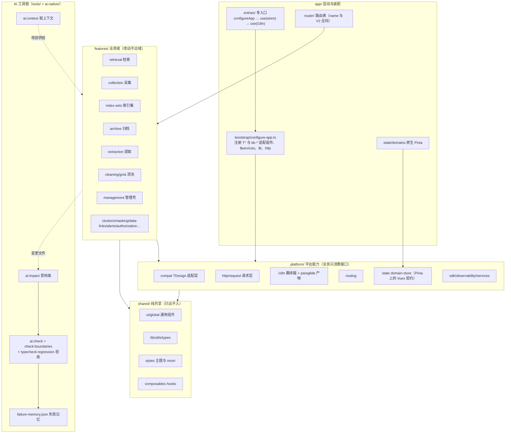
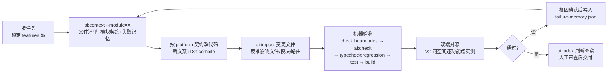

# BKLog 前端 AI-Native 迁移分享说明

> 范围：`bklog/web` 前端从 Vue2（`web-v2`，bk-magic-vue）迁移到 Vue3 + TDesign（`web-v3`）。
> 本文解释为什么做、怎么做、以及一步到位迁移失败的教训。

---

## 一、为什么要做 AI-Native 迁移

### 1. 旧技术栈已经成为交付瓶颈

- **Vue2 已停止维护**：官方 EOL，安全补丁与生态更新停滞，新依赖逐步放弃 Vue2 支持。
- **bk-magic-vue 绑定 Vue2**：2.5.x 只有 Vue2 版本，组件能力冻结，无法单独升级组件库。
- **工程链路老化**：构建慢、类型缺失、样式靠全局注入，任何小改动都要人工回归大量页面。

### 2. AI 对旧栈“看不懂”，对新栈“写得好”

这是本次迁移最核心的动因。我们希望 AI 能承接大部分增量开发，但现实是：

| 维度 | Vue2 + bk-magic-vue | Vue3 + TDesign |
| --- | --- | --- |
| 公开语料 | 私有组件库，API/插槽/事件训练语料极少 | 公开主流组件库，文档与示例充足 |
| 生成质量 | AI 频繁臆造不存在的 props/事件，代码要大量人工纠错 | 生成准确率高，常规页面基本可一次性通过 |
| 问题定位 | 全局样式 + 隐式行为，AI 改一处坏一片 | 显式 props/事件 + 局部样式，改动可控 |
| 可验证性 | 无类型、约定靠口口相传 | TS + 明确分层，可机器校验 |

AI-Native 的目标不是“用 AI 写代码”，而是**把工程改造成 AI 能安全、自主工作的形态**：架构边界清晰、约定显式、结果可机器验证，让人从写代码转向审查代码。

### 3. 架构层面：旧结构不适合 AI 操作

旧代码业务、平台能力、工具方法混杂，状态分散，组件间靠全局事件和隐式依赖连接。AI 每次修改都需要理解整个仓库才能不犯错——上下文装不下，错误率必然高。AI-Native 架构要求：

- **业务按域隔离**（`features/` 一个域一个目录，改动半径可预测）；
- **平台能力收敛**（`platform/` 统一 http/i18n/routing/state/compat，AI 不需要关心实现细节）；
- **共享资产显式**（`shared/` 的 ui/lib/styles/utils 只出不入，杜绝循环依赖）。

---

## 二、迁移过程：三步走

> 核心原则：**任何时刻都有一个可运行、可对照的基线**。旧版 `web-v2` 完整保留，迁移期间双端（V2 `:8001` / V3 `:4175`）同空间（如 `bkcc__5000140`）逐页面对比验证。

### 第一步：严格保持原结构，先保证功能（1:1 平移）

目标：**结构不变、功能零回归**，先得到一个能跑的 Vue3 骨架，再谈升级。

- 目录结构、路由表、状态字段、API 调用与 V2 一一对应，只做运行时平移，不做“顺手优化”；
- 业务组件逐文件搬迁，保持原有 props/事件/插槽签名，不允许在这一步换组件、改交互；
- i18n 保持旧 key 全兼容：`legacy-message-keys.json` 承接存量文案，新增文案走 paraglide 编译，不整体重写文案目录；
- 上游 master 的 BKLOG WEB 变更继续同步：先在 V2 `git apply`，再人工移植到 V3，保证两条线功能不漂移；
- 验收方式：同一测试空间双开 V2/V3，逐页面做覆盖性对比（列表、新建、编辑、详情、空态、权限态）。

具体来说，这一步做了四件事：

1. **路由表映射**：V2 `src/router/`（manage/retrieve/monitor/dashboard 四个文件）原样平移到 V3 `app/router/`。所有路由 `name` 保持不变（如 `collection-item-list`、`manage-collection`、`collectAdd`/`collectEdit`/`collectStorage` 采集向导路由），嵌套结构、懒加载分包（webpackChunkName）、重定向规则一一对应——这样业务代码里所有 `router.push({ name: 'xxx' })` 的跳转在 V3 不需要改一个字符串。
2. **状态字段对应**：V2 `src/store/` 平移到 V3 `app/state/`，文件逐个对应（`collect.js→collect.ts`、`constant.js→constant.ts`、`globals.js→globals.ts`、`retrieve.js`、`menu-config.ts`、`request-pool.ts`、`url-resolver.ts`，以及 `actions/`、`getters/`、`mutations/`、`modules/`、`services/` 目录）。state 字段名、mutation 类型字符串、action 分发名全部保留，业务代码里的 `store.state.xxx`、`commit('xxx')`、`dispatch('xxx')` 原样可用。
3. **i18n key 兼容策略**：存量代码里 `$t('旧文案')`、`$t('bk.xxx')` 的调用有数千处，不可能一次改完。做法是 `platform/i18n/legacy-message-keys.json`（2750+ 条）维护「旧 key → paraglide 编译 ID」映射，翻译器（`platform/i18n/i18n.ts`）先查映射再取编译产物，查不到就以原 key 直接编译；新增文案直接以原文为 key 走 paraglide 编译。旧调用零修改，新调用走新管线，两套长期共存。
4. **API 调用保留**：V2 `src/api/` 平移到 `platform/http/`（`_httpRequest.js`、`cached-promise`、`request-queue`），URL、参数、错误处理（业务 code 非 0 的提示）原封不动。这一步不封装“更好的请求层”，先让请求能原样发出去。

V2 → V3 目录对应关系（平移后的落点）：

| V2（`web-v2/src`） | V3（`web-v3/src`） | 内容 |
| --- | --- | --- |
| `router/` | `app/router/` | 路由表，name 全部保留 |
| `store/` | `app/state/` | 全局状态，字段/事件名保留 |
| `api/` | `platform/http/` | 请求层：`_httpRequest`、缓存、队列 |
| `language/` | `platform/i18n/` | 翻译器 + `legacy-message-keys.json` 承接旧 key |
| `open-telemetry.ts` | `platform/observability/` | 可观测性 |
| `views/retrieve-v2/` | `features/retrieval/workbench/` | 检索工作台，子目录同名（`collect/`、`condition-comp/`、`field-filter-comp/`、`result-comp/`、`search-bar/`、`search-result-panel/`、`sub-bar/`、`setting-modal/` 等） |
| `views/retrieve-v3/` | `features/retrieval/workspace/` | 新检索页，子目录同名（`container/`、`favorite/`、`grep/`、`search-bar/`、`search-result/`、`toolbar/` 等） |
| `views/manage-v2/log-collection/` | `features/collection/` + `features/index-sets/log-collection/` | 采集项列表、新建/编辑向导、采集项管理 |
| `views/manage-v2/log-archive/` | `features/archive/` | 归档仓库、归档列表、回溯 |
| `views/manage-v2/log-extract/` | `features/extraction/` | 日志提取配置、提取链路、下载 |
| `views/manage-v2/log-clean/` | `features/cleaning/` | 清洗配置与清洗模板 |
| `views/manage-v2/es-cluster/` | `features/clusters/` | ES 集群管理 |
| `views/manage-v2/grok-manage/` | `features/grok/` | Grok 管理 |
| `views/manage-v2/client-log/` | `features/client-logs/` | 客户端日志 |
| `views/manage/manage-data-link/` | `features/data-links/` | 数据链路 |
| `views/manage/field-masking-separate/` | `features/masking/` | 日志脱敏 |
| `views/manage/index.vue` 等管理壳 | `features/management/` | 管理模块外壳与侧栏导航 |
| `components/`、`global/` | `shared/ui/` + `shared/global/` | 公共组件（空态、JsonFormat、顶部导航等） |
| `common/`、`utils/` | `shared/lib/` + `shared/utils/` | 无业务工具方法 |
| `mixins/`、`hooks/` | `shared/composables/` | 组合式函数（`use-nav-menu` 等，业务状态使用 `app/state/domains` 原生 hooks） |
| `scss/` | `shared/styles/` | 全局样式、mixins、主题 |
| `main.js` | `app/bootstrap/` + `app/entries/` | 启动装配与多入口 |

这一步的价值：**建立基线**。之后每一步出问题，都能确定是“这一步引入的”，而不是在混杂的变更里捞针。

### 第二步：升级组件（bk-magic-vue → TDesign）

目标：**组件库替换，但不重写业务页面**。

关键策略是**兼容层先行**，而不是全量改模板：

- **全局适配层**：`platform/compat` 中用 TDesign 实现一套 `bk-*` 适配组件（`legacy-bk-controls.tsx`：bk-table/bk-select/bk-form/bk-dialog/bk-sideslider/bk-steps 等），全局注册后，存量模板与 JSX 中的 `bk-*` 标签直接落到 TDesign 实现，业务代码零改动即可渲染、可交互；
- **协议对齐**：处理 Vue2/3 的 v-model 差异（`value`+`input` ↔ `modelValue`），适配组件同时收发两套协议；表格 `clearFilter`、分页、筛选等内部 API 逐项对齐；
- **特例保留**：`bk-user-display-name` 等 NPM 业务组件保持浏览器自定义元素，不注册为 Vue 组件；
- **显式替换关键件**：适配层覆盖不了语义差异的（如 `bk-steps` 的步骤条交互）在业务代码中显式换成 `TSteps`，并重写对应样式；
- **样式找回**：bk-magic 的全局样式不再注入，逐模块对照 V2 修复布局与组件视觉（header、侧栏、骨架屏、空态、弹窗、表格单元格等）；
- **行为级对齐**：不仅是“长得像”，交互也要一致——例如管理页左侧导航的悬停浮层展开与底部**固定（Fix）**按钮，按 V2 `bk-navigation` 的真实行为复刻（未固定悬停覆盖不推内容、固定后 260px 撑开内容、图标旋转 180°）。

#### 兼容适配层的技术细节

核心文件 `platform/compat/tdesign/legacy-bk-controls.tsx`（约 680 行）用 TDesign 实现了 22 个 `bk-*` 适配组件（bk-table/bk-table-column、bk-input、bk-select/bk-option/bk-option-group、bk-steps、bk-form/bk-form-item、bk-dialog、bk-sideslider、bk-collapse/bk-collapse-item、bk-button、bk-checkbox/bk-checkbox-group、bk-radio/bk-radio-group、bk-switch、bk-tag-input、bk-popover、bk-alert、bk-exception），`app/bootstrap/configure-app.ts` 启动时 `installLegacyBkControls(app)` 一次性全局注册。实现要点：

- **结构型适配**：bk-magic 的表格是“模板里写 `<bk-table-column>` 列描述”，TDesign 是“`columns` 配置数组”。适配层把 `bk-table-column` 实现为渲染 `null` 的占位组件，父级 `bk-table` 用 `flattenNodes` 展开默认插槽（含 Fragment/数组嵌套），逐个读取列节点的 props（`label`/`width`/`filters`/`renderHeader`…）转换成 TDesign `columns`；列的自定义渲染由 `cellRenderer` 桥接——TDesign 的 `cell(h, { row, col, rowIndex })` 回调被包装成旧插槽签名 `slot({ row, column, $index })`。`bk-select` 同理：解析插槽里的 `bk-option`/`bk-option-group` 占位节点，转成 `options` 数组喂给 TDesign `Select`。
- **v-model 双协议兼容**：每个适配组件同时声明 `value`（Vue2）与 `modelValue`（Vue3）两个 prop，取值时 `modelValue ?? value`；变更时同时抛出 `update:modelValue`、`input`、`change`（select 另补 `selected`）。无论业务代码写的是 Vue2 的 `v-model`、`:value + @input` 还是 Vue3 写法都能工作，迁移期间不需要逐处改模板。弹窗类组件额外兼容 bk-magic 的 `is-show` 属性（`visibleProp` 优先读 `isShow`）。
- **内部 API 对齐**：业务代码通过 `$refs` 直调组件方法的场景逐项桥接——`bk-table` 用 `expose` 暴露 `clearFilter()`（先清空内部 `filterValue` 再透传 TDesign 实例方法）；`bk-form` 暴露 `validate(callback)`（保持“回调 + Promise”双返回语义）与 `clearError()`（映射 TDesign `clearValidate`）。分页结构 `{ current, count, limit, limitList }` 翻译成 `{ current, pageSize, total, pageSizeOptions }`；事件保持 `page-change`/`page-limit-change`/`filter-change`/`row-click`/`sort-change`/`select`/`selection-change` 原名抛出，业务侧监听零修改。
- **关闭即卸载**：`bk-sideslider`/`bk-dialog` 的内容插槽按 `isShow` 条件渲染，关闭时不挂载子树，对齐 bk-magic 的懒渲染语义（详见“坑”部分案例 1）。
- **兼容标记**：所有适配组件带 `compatConfig: { MODE: 3 }`，强制按纯 Vue3 语义运行，避免兼容构建的 Vue2 行为干扰。

特例与例外：

- **`bk-user-display-name` 特例保留**：它是 `@blueking/bk-user-display-name` NPM 包注册的浏览器自定义元素（Web Component），不是 Vue 组件。V3 在 `app/bootstrap/preload.ts` 里 import 该包完成注册，模板/JSX 中继续以原生标签使用（如 `shared/global/head-navi/index.tsx` 中 `h('bk-user-display-name', { 'user-id': ... })`），**不要**注册成 Vue 组件，否则插值时机与异步渲染行为都会变。
- **`bkui-vue` 桥接**：`@blueking/date-picker` 等 NPM 包内部 `import ... from 'bkui-vue'`，`platform/compat/tdesign/bkui-vue.ts` 提供同名导出（Select/Popover/Message/InfoBox/clickoutside 等）转发到 TDesign 实现，仅供这些包解析，项目源码禁止引用。
- **TSteps 显式替换**：步骤条的 `controllable`、`before-change` 异步闸门与样式语义差异太大，适配层的 `bk-steps` 只覆盖基础展示语义；采集向导（`features/collection/current/components/create-operation/index.tsx`）直接改用 `TSteps`/`TStepItem`，点击闸门在业务层自行实现，并在 `index.scss` 重写步骤条样式。

#### 样式找回的模块清单

bk-magic 全局样式消失后，逐模块对照 V2 找回，主要涉及：

- **全局壳**：顶部导航 `shared/global/head-navi/`、空间选择 `shared/global/bk-space-choice/`、管理页侧栏 `features/management/manage/index.vue`（含 Fix 交互样式）；
- **主题与基础样式**：`shared/styles/theme/`（`tdesign-bklog.scss` 做 TDesign 变量级 bk 化，`theme-light.scss`/`theme-dark.scss` 双主题）、`reset.scss`、`mixins/`；
- **骨架屏**：`app/skeleton/`（retrieve-loader、chart-skeleton、item-skeleton、clustering-loader）；
- **空态/异常**：`shared/ui/empty-status/`、`bk-exception` 适配组件；
- **弹窗与抽屉**：适配层 `legacy-control-styles` 补 bk 风格的遮罩/圆角/按钮排布，业务弹窗逐个核对宽度与内边距；
- **表格单元格**：状态点、操作列按钮间距、筛选弹层（`select-filter.ts`）、`renderHeader` 自定义表头的对齐；
- **检索页**：`features/retrieval/workbench/index.scss`、`workspace/index.scss`、`global-en.scss`（英文换行）、`segment-pop.scss`、`media.scss` 响应式。

验收方式不变：仍与 V2 双开对照，管理模块（采集向导四步、索引集、清洗/Grok、归档三类、提取三类、集群、订阅、数据链路等）逐页走通，不新建/删除真实业务资源。

### 第三步：改造架构，适配 AI-Native

功能与组件稳定后，才动架构：

- **`features/`**：按业务域重组（collection、index-sets、archive、extraction、retrieval、management、navigation……），一个域的改动不出域；
- **`platform/`**：收敛平台能力——compat（旧组件适配）、http、i18n、routing、state、sdk、observability，业务代码只消费接口；
- **`shared/`**：ui/lib/styles/utils/types/composables 纯共享，禁止反向依赖 features/platform；
- **状态收敛**：store 访问走 `app/state/domains` 的原生 Pinia hooks/Pinia mapState，消灭散落的 `$store.state.xxx` 直读，AI 修改时有明确契约可查；
- **可机器验证**：TS 类型 + lint + 双端对照脚本化，让 AI 的每次产出有自动化的验收关卡。

#### V3 最终架构详解

```
web-v3/src/
├── app/                  # 启动与全局状态，只装配、不写业务
│   ├── bootstrap/        # configure-app.ts：唯一全局装配点（T*/bk-* 组件、指令、
│   │                     #   全局属性 $services/$t/$renderHeader、http、服务注册）
│   ├── entries/          # 多入口：monitor-bootstrap（嵌入监控平台）、apm、trace
│   ├── router/           # 路由表（manage/retrieve/monitor/dashboard）+ async-view 版本化懒加载
│   ├── state/            # 原生 Pinia 根域与检索、采集、全局域
│   ├── shell/            # 根组件 app.tsx、404 页
│   └── skeleton/         # 全局骨架屏
├── features/             # 业务域，一个域一个目录，改动不出域
│   ├── retrieval/        # 检索：workbench（旧检索）/workspace（新检索）/core/services
│   ├── collection/       # 采集：current（列表+向导）/access（旧版向导）/ip-select
│   ├── index-sets/       # 索引集与采集项管理（log-collection/collection-item）
│   ├── archive/          # 归档：仓库/列表/回溯（classic 旧版 + current 新版）
│   ├── extraction/       # 日志提取：配置/链路/下载
│   ├── cleaning/ + grok/ # 清洗与 Grok 模板
│   ├── clusters/         # ES 集群管理
│   ├── management/       # 管理壳：侧栏导航（含 Fix）、manage-v2 管理首页
│   ├── client-logs/  data-links/  masking/  authorization/  alerts/ …  # 其余域同构
├── platform/             # 平台能力收敛，业务只消费接口、不感知实现
│   ├── compat/           # 运行时兼容：tdesign/（legacy-bk-controls、bkui-vue、info-box、
│   │                     #   runtime-contract）、vue-runtime（Vue2 风格 API 残件）
│   ├── http/ + request/  # 请求层：_httpRequest、cached-promise、request-queue、服务注册
│   ├── i18n/             # 翻译器 + legacy-message-keys.json + paraglide 编译产物
│   ├── routing/          # source-router
│   ├── state/            # domain-store：Vuex 风格契约的 Pinia 实现
│   ├── sdk/              # 三方 SDK 适配（date-picker）
│   ├── observability/    # open-telemetry
│   └── services/  persistence/  embedding/  plugins/
└── shared/               # 纯共享资产，只出不入，禁止反向依赖 features/platform
    ├── ui/ + global/     # 通用组件（empty-status、json-format-wrapper、head-navi…）
    ├── lib/              # 无业务工具（bus、message、demand-import、authority-map…）
    ├── styles/           # reset/mixins/theme/animation
    ├── composables/      # use-nav-menu、use-route、use-locale 等 hooks
    └── utils/  types/  constants/  directives/  assets/
```

职责约束：

- **`features/` 按域隔离**：域内自治（组件、composables、services、样式），跨域引用只允许经由 `shared/` 或 `platform/` 的公开接口；AI 改一个域时，上下文边界就是这个目录。域内 `classic/` 与 `current/` 子目录区分新旧两代实现，由 `app/router/async-view.ts` 的版本化懒加载（`createVersionedAsyncView`/`createManageAsyncView`）按开关分流。
- **`platform/` 能力收敛**：http/i18n/routing/compat 各有明确入口。业务状态由 `app/state/domains` 原生 Pinia stores 拥有，通用 Vuex 转换器已删除；只有 Monitor 发布协议保留独立、可审计的适配边界。
- **`shared/` 纯共享**：不允许 import `features/` 与 `platform/` 的业务实现，杜绝循环依赖；它是所有域都能安全引用的“公共地板”。
- **`app/` 启动与状态**：新增任何全局能力（组件、指令、原型属性、插件）只在 `bootstrap/configure-app.ts` 登记，入口文件（`entries/`）只做 `configureApp(app) + use(store) + use(i18n)` 的薄组合。

架构改造完成后，AI 的增量开发模式变为：读单个 `features/` 域 → 按 platform 契约编码 → 类型/lint/对照测试验证，人可以只做 review。

---

## 三、坑：一步到位直接迁移到 AI-Native 终态，失败了

第一次尝试的做法是**以最终架构为目标直接重写**：建目录、换组件、改状态、调交互同时进行。结果非常差，最终推倒重来。具体症状：

### 1. 组件升级乱七八糟

- `bk-*` 与 TDesign 组件语义并不一一对应（v-model 协议、插槽结构、内部方法如 `clearFilter`、校验行为都有差异），批量替换制造了大量**隐性破坏**：代码能编译，运行时行为不对；
- JSX 中的 kebab 标签解析规则不同，部分组件静默变成未知元素，不报错也不渲染，极难排查；
- 弹窗/抽屉的内容插槽被无条件渲染，子组件在数据未就绪时抛异常，把父级挂载一起打断——表现为整页空白，而错误埋在三层的组件深处。

### 2. UI 还原各种混乱

- bk-magic 的样式是全局注入的，迁移后整份样式消失，布局大面积错位；
- 未注册的 `bk-*` 标签被当成普通 HTML 静默渲染，页面“有内容但全裸奔”，看不出是组件问题还是样式问题；
- 没有可对照基线，每个页面都要靠记忆判断“原来长什么样”，还原标准完全失真。

### 3. 功能丢失、交互丢失

- “新建采集项”等入口直接丢失——入口按钮背后的组件没渲染，肉眼很难发现少了一个功能；
- 侧栏导航只剩悬停展开，V2 的**固定（Fix）**能力悄悄消失，不用 V2 对照根本意识不到交互少了；
- 表格筛选、表单校验、步骤条可控性等行为差异，只有逐功能点操作时才会暴露。

### 4. 具体失败案例（现象 / 根因 / 解法）

以下案例全部来自真实迁移过程，按“现象→根因→解法”记录，供后续排查同类问题参考。

#### 案例 1：弹窗插槽无条件渲染，整页空白

- **现象**：某管理页打开后直接白屏，控制台报错位置在三层深的子组件里（读取 `xxx.id` 时 `xxx` 为 `null`）。
- **根因**：bk-magic 的 `bk-dialog`/`bk-sideslider` 在关闭状态下**不渲染**内容插槽，子组件只在弹窗打开（且数据已就绪）时才挂载；TDesign `Dialog`/`Drawer` 默认始终渲染插槽内容。迁移后子组件在父页面挂载阶段就执行，而详情数据尚未返回，空引用异常把父级挂载整个打断——错误埋得深，表现却是整页空白。
- **解法**：适配层恢复懒渲染语义——`BkSideslider` 的 body/footer 插槽按 `isShow` 条件渲染、`BkDialog` 同理（关闭时不挂载子树）；个别自写弹窗在业务侧补 `v-if` 与空值保护。排查套路：白屏先看调用栈最深的组件，是不是住在某个“默认不打开”的弹窗里。

#### 案例 2：未注册的 bk-* 标签静默变成未知 HTML

- **现象**：页面“有内容但全裸奔”——文字都在，没样式、没交互，控制台无任何报错。
- **根因**：JSX/模板中未注册的 kebab 标签（如漏网的手写 `<bk-button>`）在 Vue3 中被当作原生自定义元素静默渲染，不报错；叠加 bk-magic 全局样式消失，肉眼分不清是“组件没实现”还是“样式丢了”，排查方向经常一开始就走错。
- **解法**：`installLegacyBkControls` 一次性全局注册全套适配组件，从根上杜绝漏注册；排查方法是在代码库全局搜索模板中的 `bk-` 标签名，与适配层注册表比对——不在表内的要么补适配、要么显式替换。

#### 案例 3：侧栏“固定（Fix）”交互悄悄丢失

- **现象**：管理页左侧导航看起来正常——悬停能展开浮层，没人觉得少了功能；直到与 V2 对照才发现底部“固定”按钮没了，固定后内容区让位 260px 的行为也没了。
- **根因**：`bk-navigation` 的 Fix 是组件内置行为（未固定时悬停浮层覆盖内容、固定后展开态常驻并撑开布局、底部图钉按钮切换），重写侧栏时只复刻了最显眼的悬停展开，隐性行为无人记得。
- **解法**：`features/management/manage/index.vue` 用 `isFixed`/`isExpand` 两个状态按 V2 真实行为复刻：未固定时 hover 展开为覆盖层不推内容；固定后 `is-fixed` 类撑开 260px 布局；底部按钮点击切换固定、图标随 `isFixed` 旋转 180°；鼠标离开且未固定时自动收起。**教训：交互验收必须实际操作并与 V2 对照，截图对比发现不了行为缺失。**

#### 案例 4：“新建采集项”入口丢失

- **现象**：采集项列表页渲染正常、数据正常，但页面里找不到新建入口——功能悄悄没了；自动化截图对比也不容易发现“少了一个按钮”。
- **根因**：入口按钮挂在某个未成功渲染的组件/弹层内部（同案例 2 的静默失败），页面主体不受影响，人工回归时注意力又都在列表上。
- **解法**：把验收从“看页面”升级为“按功能清单走查”——每个页面列出功能点（新建/编辑/克隆/启停/删除/查看详情/权限态/空态），双开 V2/V3 逐条操作；入口类按钮单独列清单核对。

#### 案例 5：表格筛选 API 差异（clearFilter / filter-change）

- **现象**：切换 Tab 后表格筛选条件残留，调 `$refs.table.clearFilter()` 报 `clearFilter is not a function`；或筛选生效了但 `filter-change` 回调拿到的 payload 结构与旧代码预期不符，依赖它的二次处理逻辑全线错乱。
- **根因**：bk-magic 表格的列筛选声明是 `filters: [{ text, value }]`、`filter-change` 的 payload 每个键恒为数组；TDesign 是 `filter: { list: [{ label, value }] }`，且单选筛选给的是标量。`clearFilter` 虽两边都有实例方法，但行为细节不同。
- **解法**：适配层逐项翻译——列描述里的 `filters` 转成 TDesign `filter.list`（`text→label`，按 `filterMultiple` 决定多选/单选）；`onFilterChange` 把标量统一归一化为数组后仍按旧事件名 `filter-change` 抛出；`bk-table` 用 `expose` 暴露 `clearFilter()`，先清空内部 `filterValue` 再透传 TDesign 实例方法，业务侧 `$refs` 调用零修改。

#### 案例 6：步骤条语义对不上，显式替换

- **现象**：采集向导四步流程里步骤条“可点不可控”——点击步骤直接跳走，`before-change` 校验不生效；样式也与 V2 差距明显。
- **根因**：bk-magic `bk-steps` 的 `controllable`（可点击回跳）与 `before-change`（异步闸门，返回 false 阻止切换）在 TDesign `Steps` 里没有一一对应：TDesign 用 `readonly` 表达相反语义，`onChange` 也不支持异步拦截，适配层只能做“尽力映射”。
- **解法**：语义差异大的组件不靠适配层硬撑——采集向导 `create-operation/index.tsx` 显式改用 `TSteps`/`TStepItem`，点击闸门在业务层自行实现，并在 `index.scss` 重写步骤条样式对齐 V2。**原则：适配层覆盖约 80% 常规语义，剩下语义差异大的 20% 显式替换，不在适配层里堆魔法。**

### 5. 根因与纠偏

**根因：变更维度过多，且没有基线。** 结构、组件、样式、交互四个维度同时变，任何一个回归都无法归因，修复变成无休止的救火。

**纠偏：拆成三步，每步一个维度、每步有基线。**

1. 先保持结构原样平移 → 得到“功能正确”的基线；
2. 再只换组件（兼容层先行，逐模块对照 V2 找回样式与交互）→ 得到“视觉/交互正确”的基线；
3. 最后才改架构 → 前两层已经稳定，架构改动可以被完整回归验证兜住。

### 经验总结

- **AI-Native 迁移 ≠ 让 AI 一次性重写**。AI 在“小步、有基线、可验证”的任务上表现极好，在“多维并行大爆炸”的任务上同样失控；
- **兼容层是杠杆**：先让旧代码在新运行时上跑起来，再逐个替换，比重写所有调用点快一个数量级，且风险可控；
- **保留旧版做活体规格**：V2 全程可运行、可对照，功能/视觉/交互的验收标准永远以“和 V2 一致”为准，不靠记忆和截图；
- **验收必须覆盖交互而不只是渲染**：固定侧栏、悬停浮层这类行为差异，截图对比发现不了，必须实际操作。

---

## 四、V3 相对 V2 升级的新特性

> 本节只写两套系统里真实存在、可对照代码的差异，不列“理论上更好”的项。

### 1. 国际化管理

| 维度 | V2（`web-v2/src/language/`） | V3（`web-v3/src/platform/i18n/`） |
| --- | --- | --- |
| 文案组织 | 英文翻译按用途拆成 4 个 TS 字典 `lang/en/{route,button,label,content}.ts`，由 `lang/en/index.ts` 合并为 `logEnJson`；**没有中文语言包**——`i18n.ts` 里 zh-cn 消息是「key→key」的恒等映射，靠中文原文直接兜底 | 两份扁平 JSON 目录 `messages/zh-cn.json`、`messages/en.json`（各 2700+ 条），由 inlang message-format 插件托管（`project.inlang/settings.json` 的 `pathPattern` 指向该目录）；中英文文案都显式存在 |
| key 策略 | 中文原文就是 key（`$t('新建采集项')`），英文字典以中文为 key 写译文 | 存量 key 经 `legacy-message-keys.json`（2750+ 条）映射到稳定消息 ID，形如 `control_bk_lang_e1ca51862a91`（`{来源}_{slug}_{sha256前12位}`，来源即 route/button/label/content/control）；新增文案以原文为 key，原文本身就是消息 ID |
| 编译链路 | 无编译：vue-i18n 运行时直接 import TS 字典 | `pnpm i18n:compile`（`tools/compile-messages.mjs`）调 `@inlang/paraglide-js` 把 `project.inlang/` 编译成 `.paraglide/` 下的消息函数（按 locale 分包、带 TS 声明，产物在源码树之外）；`pnpm test`/`pnpm typecheck` 都会先自动执行一次编译 |
| 运行时调用 | vue-i18n 实例的 `t`，并挂到 `window.$t`；bk-magic 自身语言包（`lang.zhCN/lang.enUS`）混入 messages | `i18n.ts` 自建翻译器（`translator.ts` 的 `createTranslator`）：**先查 `legacy-message-keys.json` 把旧 key 翻成消息 ID，再以原 key 直接查编译产物 Map**，两步都查不到就把 key 本身当模板做插值兜底（`formatFallbackMessage`）。暴露方式保持旧习惯：`$t` 全局属性、`window.$t`、模板 `<i18n>` 组件（`translation.ts` + `rich-translation.ts` 支持插槽富文本）、组合式用 `shared/composables/use-locale.ts` 的 `t()` |
| 组件库文案 | 直接混入 bk-magic-vue 的语言包 | TDesign 厂商词表 `tools/vendor-control-locale/{zh-CN,en-US}.json` 在目录迁移时一次性并入消息目录 |
| 新增文案怎么走 | 在 `lang/en/` 对应分类文件里加一条「中文原文: 英文译文」 | 代码里直接 `t('新文案')`/`$t('新文案')` → 把原文与译文分别补进 `messages/zh-cn.json`、`messages/en.json`（key 就是原文）→ 跑 `pnpm i18n:compile` 重新编译。当前两份目录的 key 全部是带前缀的稳定 ID（grep 可验证无原文 key），即存量文案 100% 走了迁移映射，新增文案按此约定进入同一编译管线 |
| 存量目录从哪来 | —（人工维护） | 当前词条在 `src/platform/i18n/messages/`。历史快照已退役，AI-Native 只校验当前源码；不再从冻结源码恢复词条。直接改这两份 JSON 后运行 `pnpm i18n:compile` |

要点：V3 的翻译器查找顺序是「旧 key 映射 → 原文 key → 兜底插值」，所以存量数千处 `$t('旧文案')` 零修改，新文案走新管线，两套长期共存；vue-i18n 只作为兼容依赖存在，业务代码不再直接持有 vue-i18n 实例。

### 2. 状态管理

2026-11-12 批次 03 已将 application 根状态、retrieve、collect、globals 收敛为原生 Pinia。主应用和 Monitor 的 Vue3 应用安装 Pinia；业务组件不再调用 Vuex 风格的 state/getters/commit/dispatch，也不依赖通用转换器或旧 map helpers。

- 直接导入 `app/state/domains/{application,retrieve,collection,globals}-store.ts`；根域字段为扁平状态。原始 `visibleFields` 与派生 `resolvedVisibleFields` 分开，禁止混用。
- 根域保留 40 个具名同步 action、17 个具名异步 action。方法的 API、缓存、本地存储、权限、取消和回填副作用保留在原服务与具名状态操作中。Options API 使用 Pinia 的 `mapState`；跨域 selector 使用函数，不能把 `globals/globalsData` 当作原生字段名。
- 主应用启动使用 `app/state/pinia.ts`。独立测试/嵌入组件可显式传入 Pinia，组件内默认遵循注入的拥有者。请求池和查询会话按拥有者隔离；Devtools 的 action 代理不改变会话身份。
- `app/state/index.ts` 和 `monitor-store-compatibility.ts` 只维护 Monitor 已发布的 logStore 协议（含第三参 config、对象调用、subscribeAction）。它们直接转发原生 action，不拥有第二份 state。内部业务禁止导入这一边界。
- 已删除 `platform/state/domain-store.ts`、`state-runtime.ts`、旧 action/getter 字典、旧 retrieve 定义、`map-helpers.ts`、`use-store.ts`。
- 执行 `pnpm --ignore-workspace check:native-state`，同时检查脚本和 Vue 模板，防止旧接口及字符串命名空间 selector 回流。该检查不能替代真实业务验收。

本批证据见 `analyze-info/reports/alignment-audit-20261112/实施记录-03-根状态原生Pinia与Monitor聚类验证.md`；尚有存量测试和类型错误，不能据此宣称全业务验收通过。

### 1. 能力清单（V2 均不存在）

| 能力 | 入口（真实文件） | 实际做什么 |
| --- | --- | --- |
| 依赖索引 `ai:index` | `tools/ai-native.mjs` 的 `index` 命令 | 全量扫描 `src/`，用 TS AST + Vue SFC 解析提取依赖边：ES import/re-export（type-only 单独标记）、字面量动态 import/require、Worker/URL/`import.meta.glob`、模板资源（src/href/url()）、Sass `@import/@use`，以及 `ServicesInstance.ns.action` 和 `http.request('ns/action')` 服务调用（经 `app/bootstrap/service-definitions.ts` 解析提供方）。产出 `ai-native/dependency-graph.json`、`ai-native/modules.json` 和 29 个模块描述文件（`ai-native/modules/*.json`，含入口、服务文件、跨域依赖、文件数） |
| 迁移校验 `ai:check` | `tools/ai-native.mjs` 的 `check` 命令 | 逐项硬校验当前源码：`source-map.json` 迁移清单计数与目标文件存在性、源码中禁止出现 `src-native/` 运行时引用、新增未解析 import（对照 `unresolved-baseline.json` 白名单）、**新增 platform/shared → features 的反向依赖**（`boundary-debt.json` 之外的即报错，type-only 边豁免）、路由对象签名与 `route-signatures.json` 逐字比对、`dependency-graph.json` 是否过期。历史快照已退役，AI-Native 只校验当前源码。任一失败退出码为 1 |
| 上下文包 `ai:context` | `tools/ai-native.mjs` 的 `context` 命令 | 按 `--module=retrieval` 或指定文件生成有界上下文：入口优先的文件清单（默认 30 条上限，可 `--limit` 到 100）、涉及的模块描述文件位置、受影响路由（从 `routes.json` 反查）、失败记忆文件指针、建议验证命令，并附「静态图谱保守、动态路径仍需浏览器验证」的局限声明 |
| 影响面 `ai:impact` | `tools/ai-native.mjs` 的 `impact` 命令 | 从变更文件出发在静态依赖图上反向 BFS（支持循环引用），列出受影响的文件、所属模块与可达路由 |
| 三方边界审计 `check:boundaries` | `tools/third-party-boundary-audit.mjs` | 冻结 BlueKing SDK 的引用属主：每个 `@blueking/*` 包有明确白名单文件（如 date-picker 只能由 `shared/ui/time-range/` 经 Vue3 入口引入、notice-component 只能由 `app/shell/app.tsx` 引入）；业务源码直接 import `bk-magic-vue`/`bkui-vue` 一律报错（除登记的 tracked debt）；白名单外的 `bk-*` 全局组件/指令注册报错。输出报告可写入 `ai-native/third-party-boundary.json` |
| bk-* 存量审计 `check:tdesign` | `tools/business-control-audit.mjs` | 扫描全部业务源码（模板 AST + TS/JSX AST）中残留的 `bk-*`/`Bk*` 组件、`v-bk*` 指令、`$bkMessage` 等服务调用与 bk-magic-vue import，适配层桥接文件（`platform/compat/`）与外部 Web Component（bk-user-selector 等）豁免；有残留则状态 `INCOMPLETE`，用于跟踪旧组件清零进度 |
| 源码基线 | — | 历史快照已退役，AI-Native 只校验当前源码。`test:baseline` / `verify:baseline` 已从 `package.json` 移除，不再解压或校验迁移前归档 |
| 源码布局 `check:source` | `tools/check-source-layout.mjs` | 保证 `src/` 下不再残留任何 `.js/.jsx/.mjs/.cjs`（TS 化完成的标志），且不存在 `src-native`/`src-prototype` 重复源码树 |
| 类型回归 `typecheck:regression` | `tools/typecheck-regression.mjs` | 用 vue-tsc 跑当前 `src`，对照 `ai-native/typecheck-status.json` 的文件与错误码计数，**只允许不新增**。该文件是当前门禁（2026-10-29：1271 条，较上期 1349 条下降）。历史快照已退役，AI-Native 只校验当前源码 |
| 失败记忆 | `ai-native/failure-memory.json` | 26 条结构化缺陷记录（schemaVersion 2），每条含症状、根因、修复模式、影响范围、回归验证与证据链接；规则是「必须来自已确认的缺陷，禁止记录推测」，供 `ai:context` 检索引用，同一问题重复失败时先做根因分析 |
| 任务纪律 | `ai-native/task.schema.json` + `ai-native/README.md` | 任务状态必须经过分析、实施、验证；证据不足保持 `NEEDS_REVIEW`/`BLOCKED`；禁止把「目录迁移成功」或「一次构建成功」当作全量功能通过 |

串起来的总入口是 `pnpm verify`：`check:boundaries` → `ai:check` → `test`（先 `i18n:compile` 再 `node --test`）→ `build`，一条命令跑完全部机器验收。

### 2. AI-Native 如何运行（按脚本真实入口）

以「改一个 features 域」为例，人从写代码转向审查，代理按固定管线工作：

1. **接任务、定边界**：按 `ai-native/task.schema.json` 建任务记录，先确定改动属于哪个域（如 `features/retrieval`），改动半径原则上不出域。
2. **取上下文**：`pnpm --ignore-workspace ai:context --module=retrieval --limit=30` 拿到入口优先的文件清单、模块描述（`ai-native/modules/features-retrieval.json`：454 个文件、入口点、服务、跨域依赖）、受影响路由和 `failure-memory.json` 里该域的历史坑。
3. **按契约改代码**：跨域只走 `platform/` 与 `shared/` 的公开接口；新文案直接 `t('原文')` 并补两份 messages JSON 后跑 `i18n:compile`；状态改动走 `app/state/` 同名文件。
4. **看影响面**：`pnpm --ignore-workspace ai:impact features/retrieval/xxx.tsx` 反推受影响文件、模块与路由，确定回归范围。
5. **机器验收**：`pnpm --ignore-workspace check:boundaries`（SDK 边界）→ `ai:check`（完整性/反向依赖/路由签名/图谱）→ `pnpm --ignore-workspace typecheck:regression`（对照 `typecheck-status.json`，无新增类型错误）→ `pnpm --ignore-workspace test` → `pnpm --ignore-workspace build`；或直接一条 `pnpm verify`。历史快照已退役，AI-Native 只校验当前源码。
6. **双端对照**：与 V2（`:8001`）同空间逐功能点操作对照，静态图谱覆盖不到的动态路径必须浏览器实测（README 明确要求）。
7. **刷新索引**：`pnpm --ignore-workspace ai:index` 刷新依赖图谱与模块描述；新增依赖债务、路由变化不会被自动接受，必须人工说明依据。
8. **失败闭环**：验收暴露的缺陷确认根因后写入 `failure-memory.json`（症状/根因/修复/验证/证据五要素齐全），下次 `ai:context` 自动带到同类任务面前；证据不齐的改动保持 `NEEDS_REVIEW` 或 `BLOCKED`，不允许强行交付。

### 架构图

V3 运行时分层（含 AI 工具链位置）：



AI-Native 工作流（从接任务到验收）：


