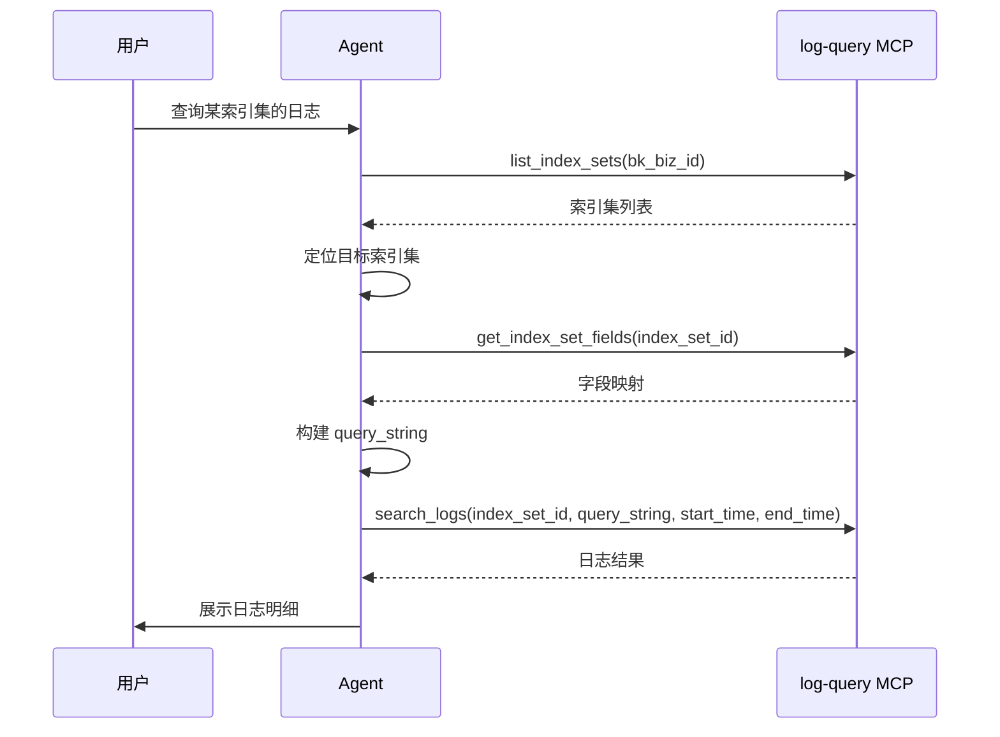
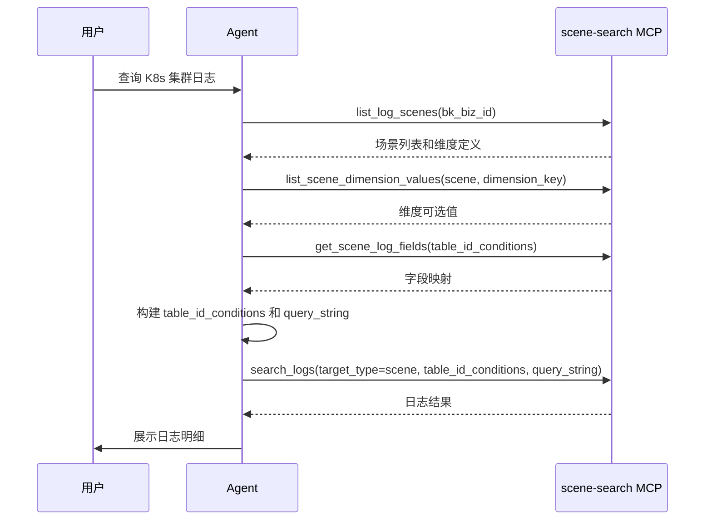
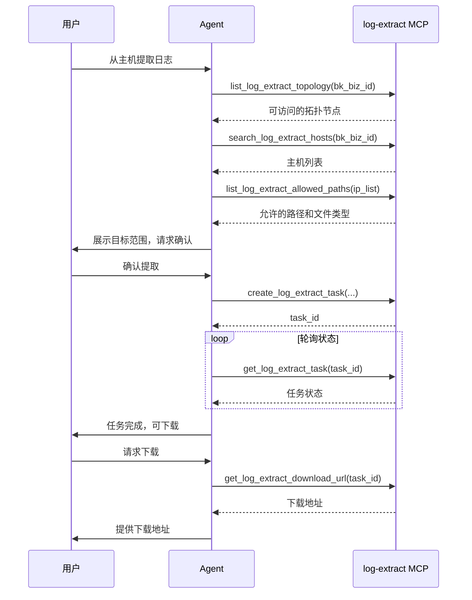

# MCP 工作流参考

本文档描述日志查询与提取的 MCP 工具调用流程。

所有请求块仅用于说明字段语义。实际调用前必须读取目标工具最新 schema，并将示例资源替换为工具发现结果；`${...}` 表示动态占位符。任何返回示例均视为 `mock response`，不能作为执行证据。

## MCP Server 概览

| Server | 用途 | 主要工具 |
| --- | --- | --- |
| `log-query` | 索引集日志查询 | list_index_sets, get_index_set_fields, search_logs, search_log_clustering_pattern, analyze_field, search_index_set_context |
| `log-scene-search` | K8s、Host和自定义应用等场景日志查询 | list_log_scenes, list_scene_dimension_values, get_scene_log_fields, search_logs |
| `log-extract` | 临时日志提取 | list_log_extract_topology, search_log_extract_hosts, list_log_extract_allowed_paths, search_log_extract_files, create_log_extract_task, get_log_extract_task, get_log_extract_download_url |

以上是监控 MCP Server 的后缀。只在已确认的目标网关和发布环境内发现完整 Server 名称；客户端前缀可能不同。

## 索引集日志查询工作流



### 工具调用详情

#### 1. list_index_sets

列出业务下所有索引集。

```json
{
  "query_param": {
    "bk_biz_id": "<bk_biz_id>"
  }
}
```

#### 2. get_index_set_fields

获取索引集字段映射。

```json
{
  "query_param": {
    "bk_biz_id": "<bk_biz_id>",
    "index_set_id": "${INDEX_SET_ID_FROM_LIST}"
  }
}
```

#### 3. search_logs

执行日志搜索。

```json
{
  "body_param": {
    "bk_biz_id": "<bk_biz_id>",
    "index_set_id": "${INDEX_SET_ID_FROM_LIST}",
    "query_string": "level:ERROR",
    "start_time": "${START_TIME_SECONDS}",
    "end_time": "${NOW_SECONDS}",
    "limit": 20
  }
}
```

#### 4. search_log_clustering_pattern

搜索日志聚类模式。

```json
{
  "body_param": {
    "bk_biz_id": "<bk_biz_id>",
    "index_set_id": "${INDEX_SET_ID_FROM_LIST}",
    "start_time": "${START_TIME_MILLISECONDS}",
    "end_time": "${NOW_MILLISECONDS}",
    "pattern_level": "05",
    "show_new_pattern": false,
    "size": 10
  }
}
```

从聚类下钻到原始日志：

```json
{
  "body_param": {
    "bk_biz_id": "<bk_biz_id>",
    "index_set_id": "${INDEX_SET_ID_FROM_LIST}",
    "query_string": "*",
    "conditions": {
      "field_list": [
        {"field_name": "__dist_05", "op": "eq", "value": ["返回的signature"]}
      ],
      "condition_list": []
    },
    "start_time": "...",
    "end_time": "..."
  }
}
```

#### 5. analyze_field

分析字段分布。

```json
{
  "body_param": {
    "bk_biz_id": "<bk_biz_id>",
    "index_set_id": "${INDEX_SET_ID_FROM_LIST}",
    "field_name": "level",
    "start_time": "${START_TIME_SECONDS}",
    "end_time": "${NOW_SECONDS}",
    "group_by": true,
    "limit": "20",
    "order_by": "value"
  }
}
```

#### 6. search_index_set_context

获取日志上下文。

```json
{
  "body_param": {
    "bk_biz_id": "<bk_biz_id>",
    "index_set_id": "${INDEX_SET_ID_FROM_LIST}",
    "dtEventTimeStamp": "从search_logs获取",
    "serverIp": "从search_logs获取",
    "gseIndex": "从search_logs获取",
    "begin": 0,
    "size": "50",
    "zero": true
  }
}
```

## IaaS 场景日志查询工作流



### 工具调用详情

#### 1. list_log_scenes

获取业务可用的日志场景。

```json
{
  "query_param": {
    "bk_biz_id": "<bk_biz_id>"
  }
}
```

返回示例：
```json
{
  "scenes": [
    {
      "scene": "k8s",
      "dimensions": [
        {"key": "cluster_id", "choices_type": "dynamic"}
      ]
    }
  ]
}
```

#### 2. list_scene_dimension_values

获取动态维度的可选值。

```json
{
  "body_param": {
    "bk_biz_id": "<bk_biz_id>",
    "scene": "k8s",
    "dimension_key": "cluster_id",
    "filters": []
  }
}
```

只有实时场景 schema 声明为动态维度的字段才能调用本工具。例如某些 K8s 场景中，不应查询 `namespace` 动态值；命名空间是日志内容字段。

#### 3. get_scene_log_fields

获取场景下的字段映射。

```json
{
  "body_param": {
    "bk_biz_id": "<bk_biz_id>",
    "table_id_conditions": [
      [
        {"field_name": "scene", "value": ["k8s"], "op": "eq"},
        {"field_name": "cluster_id", "value": ["BCS-K8S-00000"], "op": "eq"}
      ]
    ]
  }
}
```

#### 4. search_logs (场景模式)

执行场景日志搜索。

```json
{
  "body_param": {
    "bk_biz_id": "<bk_biz_id>",
    "target_type": "scene",
    "table_id_conditions": [
      [
        {"field_name": "scene", "value": ["k8s"], "op": "eq"},
        {"field_name": "cluster_id", "value": ["BCS-K8S-00000"], "op": "eq"}
      ]
    ],
    "query_string": "__ext.io_kubernetes_pod_namespace:\"default\" AND level:ERROR",
    "start_time": "${START_TIME_SECONDS}",
    "end_time": "${NOW_SECONDS}",
    "limit": 20
  }
}
```

**注意**：

- 场景模式不支持 `conditions` 参数，所有内容过滤条件需通过 `query_string` 表达。
- `table_id_conditions` 仅放实时 schema 中的路由维度；字段名不得从静态示例推断。
-自定义应用场景同样先发现 schema，再按真实字段支持服务名、目标服务、命名空间、环境、级别、容器、实例 IP 和 Trace ID。

## 临时日志提取工作流

下列请求仅说明字段语义，不是绕过实时 schema 的固定契约。调用每个工具前必须重新读取公开 schema；若 allowed-path、file-search、create-task、poll 或 download 缺少业务、主机、路径、过滤或任务 ID 等关键字段，或主机元素类型与上一步返回不兼容，必须停止并报告契约漂移。



### 工具调用详情

#### 1. list_log_extract_topology

获取用户可访问的拓扑节点。

```json
{
  "body_param": {
    "bk_biz_id": "<bk_biz_id>"
  }
}
```

#### 2. search_log_extract_hosts

查询可提取日志的主机。

```json
{
  "body_param": {
    "bk_biz_id": "<bk_biz_id>",
    "search_content": "${TARGET_HOST_IP}",
    "page_size": 20,
    "start": 0
  }
}
```

#### 3. list_log_extract_allowed_paths

查询允许的目录和文件类型。

实时 schema 必须能表达 `bk_biz_id` 和服务端要求的主机对象。示例中的主机结构只是占位，实际结构取自 `search_log_extract_hosts` 返回和当前 tool schema。

```json
{
  "body_param": {
    "bk_biz_id": "<bk_biz_id>",
    "ip_list": [
      {"bk_host_id": "${BK_HOST_ID_FROM_SEARCH}"}
    ]
  }
}
```

#### 4. search_log_extract_files

预览匹配的文件列表（会执行真实 JOB）。

```json
{
  "body_param": {
    "bk_biz_id": "<bk_biz_id>",
    "ip_list": [
      {"bk_host_id": "${BK_HOST_ID_FROM_SEARCH}"}
    ],
    "path": "/data/logs/",
    "is_search_child": true,
    "time_range": "1d"
  }
}
```

#### 5. create_log_extract_task

创建提取任务（需用户确认后调用）。

实时 schema 必须同时包含业务、主机、文件路径、过滤类型和过滤内容；缺任一关键字段都不得提交。

```json
{
  "body_param": {
    "bk_biz_id": "<bk_biz_id>",
    "ip_list": [
      {"bk_host_id": "${BK_HOST_ID_FROM_SEARCH}"}
    ],
    "file_path": ["/data/logs/app.log"],
    "filter_type": "tail_line",
    "filter_content": {
      "line_num": 1000
    }
  }
}
```

#### 6. get_log_extract_task

轮询任务状态。

```json
{
  "query_param": {
    "bk_biz_id": "<bk_biz_id>",
    "task_id": "${TASK_ID_FROM_CREATE}"
  }
}
```

返回 `terminal: true` 时停止轮询。

#### 7. get_log_extract_download_url

获取下载地址（仅在用户请求时调用）。

```json
{
  "body_param": {
    "bk_biz_id": "<bk_biz_id>",
    "task_id": "${TASK_ID_FROM_CREATE}"
  }
}
```

保留签名 URL 中的原始对象名。下载后如需解压，先检测真实文件类型，不根据 `.tgz` 或 `.tar.gz` 后缀直接选择解压命令。

## 时间戳计算

所有查询的时间戳必须动态计算：

```python
import time

# 秒级时间戳（search_logs, analyze_field）
end_time = int(time.time())
start_time = end_time - 3600  # 最近 1 小时

# 毫秒级时间戳（search_log_clustering_pattern）
end_time_ms = str(int(time.time() * 1000))
start_time_ms = str(int(time.time() * 1000) - 3600000)
```

**重要**：查询跨度不得超过 1 天（86400 秒），超过需分批查询。
